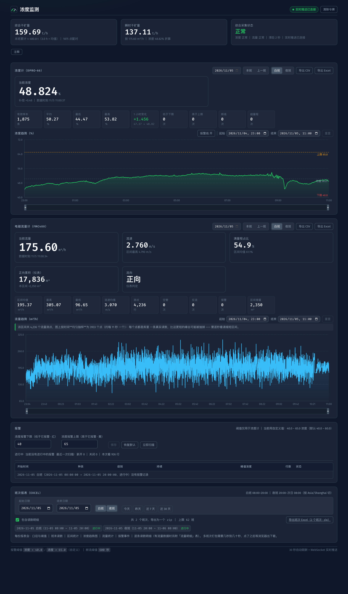
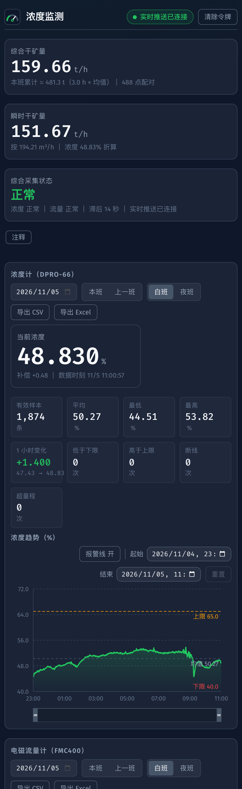

# ECAS 浓度监测网站 

## 一、这是什么

现场浓度计与流量计的数据自动上传，网页上**实时显示**浓度、流量和折算出的干矿量；可按班次导出 Excel 报表。手机、电脑浏览器都能用，无需装软件。

**网址**：https://gateway.xshky.org （境外网络用备用：https://gateway.data-monitor.workers.dev ）

## 二、账户清单（共 8 个在用）

| 姓名 | 账号 | 角色 | 可登录设备 |
| --- | --- | --- | --- |
| 廖大文 | `ldw` | 普通 | 5 台 |
| 董文富 | `dwf` | 普通 | 5 台 |
| 朱从福 | `zcf` | 普通 | 5 台 |
| 徐彬 | `xb` | 普通 | 5 台 |
| 彭鑫锴 | `pxk` | 普通 | 5 台 |
| 钱光斌 | `qgb` | 普通 | 5 台 |
| 调度室 | `dds` | 普通 | 5 台 |

- 初始密码由管理员统一发放，密码为：`cwky8888`。登陆后可在右上角「姓名 → 修改密码」改成自己的。
- 需要新开账号、重置密码、停用人员，都由管理员在管理台办理。

## 三、功能一览

**1. 顶部三块关键指标**
综合干矿量（当前 + 本班累计）、瞬时干矿量、采集状态（正常 / 异常一眼可见）。

**2. 浓度监测（DPRO-66）**
当前浓度（%）、本班有效样本数、平均 / 最低 / 最高、1 小时变化、低于下限 / 高于上限 / 断线次数；下方是 24 小时浓度趋势图，可拖拽缩放、显示报警线。

**3. 流量监测（FMC400）**
当前流量（m³/h）、流速、满管率、正向累积、流向判断，以及区间平均 / 最高 / 最低 / 超量程次数和流量趋势图。

**4. 告警**
默认浓度低于 **40.0 %** 或高于 **65.0 %** 记录一条告警（阈值可改），列表显示时间、级别、持续时长、峰值浓度。

**5. 班次报表**
按白班 08:00–20:00、夜班 20:00–次日 08:00 导出 Excel / CSV，含每班汇总、区间统计、趋势、流量、报警明细，可一次打包多个班次。

## 四、手机上一样用

## 五、使用时注意

1. 一个账号**同一时间只能在一台设备登录**，换设备登录会把原来的踢下线（这是防共享的保护，不是故障）。
2. 普通账号最多绑定 5 台设备。
3. 忘记密码找管理员重置，重置后首次登录需改密。
4. 页面每 30 秒自动刷新；数据中断超过 10 分钟会告警。
