# ECAS 浓度计监测网站 · 全流程布局

> 视角：**从现场仪表到浏览器屏幕的每一段**，以及屏幕上从上到下的每一块。
> 部署细节（安全加固、mosquitto ACL、systemd、踩坑）见 [`docs/ECAS部署与踩坑手册.md`](./ECAS部署与踩坑手册.md)；本文只讲**布局与流程**。
>
> 对应版本：前端提交 `bdd25cf`（统计条修复）／`d9592c3`（手机端表格卡片式），线上产物 `index-KlH7v4Yd.js` + `index-Cd07-xjt.css`。

---

## 0. 一页速览

```mermaid
flowchart LR
  A["DPRO-66 浓度计<br/>4~20 mA / RS485"] --> B["塔石 DTU<br/>TAS-KS-301"]
  B -->|"MQTT 明文 8883（现场 DTU 口）<br/>主题 dpro66 + 认证 + 主题 ACL"| C["腾讯云 mosquitto<br/>订阅账号 ecas-monitor（只读）"]
  C -->|"TLS 8884，经叠加网 10.10.10.123<br/>叶子证书指纹钉扎"| D["ecas-collector<br/>mqtt_tls_feeder.py → dpro66_monitor.sh --pipe"]
  D -->|"唯一写入者"| E[("PostgreSQL 16<br/>raw_reading")]
  E -->|"只读"| F["ecas-api（FastAPI）<br/>/api/*　/ws/readings　静态站"]
  F --> G["nginx ecas-edge（腾讯云）<br/>（2026-10-26 起已停用）"]
  G --> H["浏览器 SPA"]
  I["Cloudflare Worker gateway<br/>（2026-10-26 起 403 封锁桩）"] -.->|"已切断"| F
  H -.->|"登录后走账户层"| I
```



一句话：**现场仪表 → MQTT → 采集器 → PostgreSQL → FastAPI → 反向代理/账户网关 → 浏览器**。
其中数据库只有采集器写、后端只读（后端唯一会写的是两张报警表）；浏览器手里的令牌是占位符，真令牌只在 Worker 密钥里。

---

## 1. 页面从上到下（单页应用，`web/frontend/src/App.tsx`）

| # | 区块 | 组件 | 内容与字段 |
|---|---|---|---|
| — | **页头** `App.tsx:160` | 内置 | 标题 `ECAS · 浓度计实时监测`；副标题 `DPRO-66 ｜ 塔石 DTU → MQTT → PostgreSQL ｜ 4~20 mA ↔ 0~100`；右侧状态胶囊：**进行中报警 N**（有才显示）、**实时推送已连接/未连接**、**清除令牌**（仅“需令牌且已带令牌”时）、**数据新鲜度**（`数据新鲜（滞后 …）`／`无新数据 …`／尚未取到数据） |
| 0 | **令牌门** | `TokenGate.tsx` | 未带令牌时只显示输入框 + `TokenGate`；页脚注明 `/healthz` 与 `/api/auth` 无需令牌 |
| 1 | **KPI 四卡** | `KpiCards.tsx` | ① 当前浓度（主卡，附 `alarm-tag` 高/低标签）② 电流 mA ③ 原始值 uint16 ④ 状态（+ 数据时刻） |
| 2 | **区间统计条** | `SummaryStrip.tsx` | 9 格：区间（`24 小时`）／有效样本／平均浓度／最小·最大／原始值范围／异常行（断线·偏低·超量程）／越限（下限·上限）／库存总量／最新数据滞后 |
| 3 | **浓度趋势** | `App.tsx:218` + `TrendChart.tsx` | 卡片头：**报警线 开/关**、**导出 CSV（N 小时）**、**时间区间 tabs**（`1 小时 / 24 小时 / 7 天 / 30 天`，默认 24）；图体 `ResponsiveContainer > AreaChart`，Area 绿色、断线点不画，三条 `ReferenceLine`（上限/下限/均值），悬停 `ChartTooltip` |
| 4 | **报警事件** | `AlarmPanel.tsx` | 阈值表单（下限/上限 → **保存 / 恢复默认 / 立即扫描**，阈值存后端 `alarm_config` 表）+ 扫描摘要（`最近一次扫描: 新开 N ｜ 关闭 N ｜ 本次看 M 行`）+ 表格 **8 列**：开始时间/种类/级别/持续/峰值 raw/峰值浓度/行数/状态 |
| 5 | **最近读数** | `App.tsx:262` + `RecentTable.tsx` | 卡片头：`越限判据：40.0 ~ 70.0 浓度（raw 10323 ~ 15123）`；表格 **6 列**：时间/原始值/电流 mA/未补偿/浓度/状态，最多 **25** 行（`TABLE_ROWS`） |
| 6 | **班次报表（Excel）** | `ShiftExport.tsx` | 选日期范围 + 班次类型（白班 / 夜班，默认全选），先预览「共 N 个班次」；导出时单班 → `.xlsx`、多班 → `.zip`。每份含 元信息／班末读数／区间统计／**曲线图**／报警事件 ＋ `读数明细` 第二张表；上限 31 天 / 62 班 |
| — | **页脚** `App.tsx:275` | 内置 | 换算口径公式、未补偿公式、报警阈值（含“看板自定义/出厂默认”）、断线 `raw < 3600`、超量程 `raw > 20500`、断流阈值 `600 秒`、`30 秒自动刷新 + WebSocket 实时推送` |

> 桌面端两张表都是常规 `<table>`；**窄屏（≤640px）自动变成卡片**，每个数值前面带字段名（详见 §5）。

---

## 2. 交互与刷新节奏

| 行为 | 触发 | 影响范围 |
|---|---|---|
| 定时轮询 | `POLL_MS = 30_000`（`App.tsx:117`） | `/api/readings`、`/api/summary`、`/api/health`、`/api/alarms` 全量刷新 |
| 实时推送 | WebSocket `/ws/readings`（`hooks/useLiveReading.ts`） | 库里一有新行就推，页面立刻追加；连接状态显示在页头胶囊 |
| 切时间区间 | tabs | 趋势图 + 统计条 + 报警事件 + 导出 CSV 都跟随同一个 `hours` |
| 改报警阈值 | 保存 / 恢复默认 | `PUT|DELETE /api/alarms/config` 后调 `onChanged()` 让整页重取 |
| 手动扫描 | 立即扫描 | `POST /api/alarms/scan`，回显新开/关闭条数 |
| 导出 CSV | `<a download href={exportCsvUrl(hours)}>` | 令牌只能走查询串 `/api/export.csv?hours=N&token=…`（`<a>` 带不了请求头） |
| 导出班次报表 | `ShiftExport` 卡片里选日期 + 班次类型 | **独立于 `hours`**：不跟随时间区间 tabs（班次按自然日切，跟随 `hours` 会把半个班次也切进来）；同样只能走 `?token=` |
| 鉴权 | 令牌存 `localStorage.ecas_token`（`api.ts:111`） | 每个 `fetch` 加 `Authorization`；经网关时是 Worker 注入的**占位符** |

---

## 3. 接口清单（后端 `web/backend/app/main.py`）

| 端点 | 方法 | 用途 | 鉴权 |
|---|---|---|---|
| `/healthz` | GET | 探针（纯文本） | 无 |
| `/api/auth` | GET | 值守门状态：是否需要令牌 | 无 |
| `/api/params` | GET | 型号、量程、报警阈值、判据、口径公式 | 有 |
| `/api/health` | GET | 总行数、最新时间戳、滞后秒数、是否 stale | 有 |
| `/api/readings?hours=&limit=` | GET | 趋势点 + 最近读数行 | 有 |
| `/api/summary?hours=` | GET | 统计条 9 项 + 区间变化 | 有 |
| `/api/alarms?hours=&limit=` | GET | 报警事件分页 + 进行中条数 | 有 |
| `/api/alarms/config` | PUT / DELETE | 自定义阈值 / 恢复出厂默认 | 有 |
| `/api/alarms/scan` | POST | 立即扫描一次 | 有 |
| `/api/export.csv?hours=` | GET | 导出 CSV | 有（`?token=`） |
| `/api/shifts?start=&end=&kinds=` | GET | 班次清单预览（白班 08:00–20:00 / 夜班 20:00–次日 08:00，只算时间不查数据） | 有 |
| `/api/export/shifts?start=&end=&kinds=` | GET | 按班次导出 Excel（单班 `.xlsx` / 多班 `.zip`，含 matplotlib 曲线图） | 有（`?token=`） |
| `/ws/readings` | WS | 新读数推送 | 有（`?token=`） |
| `/internal/accounts*` | GET / POST / PATCH / DELETE | **后端内部账户接口**（前缀 `/internal/accounts`，`accounts.py:377`）：建号 / 改密 / 导入 / 校验 / 启停。⚠️ 用的是**另一个专用令牌** `ECAS_INTERNAL_TOKEN`，与看板令牌分开（安全审查 M-02） | 有（内部令牌） |
| `/login` `/logout` `/password` `/api/session` `/admin/accounts[.json]` | — | **账户层（Cloudflare Worker）**：登录/改密/会话/账户管理。Worker 再以内部令牌转发到上面的 `/internal/accounts*` | 会话 cookie `dm_session` |

⚠️ 静态站挂载 `app.mount("/", StaticFiles(...))` 在**所有 API 之后**注册（`main.py:698`，对应的警示注释在 `main.py:260`），否则会把接口吞掉。
⚠️ **后端容器监听 `8000`**（`ECAS_PORT=8000`）。现网由 compose 映射为 **`127.0.0.1:18080 → 8000`**（`docker-compose.yml:93`；2026-10-26 安全收口后只绑回环，叠加网/公网都到不了，仅先生本机 SSH 隧道可达）；本地开发栈直接跑 `8080`。⚠️ 腾讯云那台机器上的旧 `ecas-web`（`127.0.0.1:8080`）**已不是现网** —— 其单元已是 `disabled` + `inactive (dead)`，见 [`云端部署.md`](./云端部署.md) 顶部横幅。
⚠️ `/docs`、`/redoc`、`/openapi.json` 默认**关闭**（安全审查 M-01）；临时要看设 `ECAS_ENABLE_DOCS=1`。

---

## 4. 数据链路与口径（改算法前必读）

1. **现场**：DPRO-66 浓度计 4~20 mA／RS485 → 塔石 DTU（TAS-KS-301）→ 发布到 MQTT 主题 `dpro66`。
2. **传输**：腾讯云 mosquitto 有两个面 —— **8883 明文**＝现场 DTU 口（塔石 DTU 实测只会发明文 MQTT，安全靠账号口令 + 主题 ACL + 最小权限 + 冒名检测兜底；1883 只绑 `127.0.0.1`，仅供本机订阅）；**8884 TLS**＝安全组未放行，只作采集器经叠加网取数的通道。发布用现场账号，采集用**只读账号 `ecas-monitor`**。
3. **采集**：`ecas-collector` 走叠加网连 `10.10.10.123:8884`（该地址不在证书 SAN 里 ⇒ 关主机名校验、改用**叶子证书 SHA-256 指纹钉扎**，链校验仍 `CERT_REQUIRED`，指纹不匹配就 fail closed 拒绝订阅）。
   - 管道左半 `mqtt_tls_feeder.py` 按 `%I|%x` 吐出 `ts|hex` 行；
   - 右半直接复用仓库里的 `scripts/485/dpro66_monitor.sh --pipe`（解析/去重/换算/判异常/入库**一字不改**），保证只有一份实现。
4. **入库**：PostgreSQL 表 **`raw_reading`** —— 采集端是**唯一写入者**；后端只读。
5. **换算口径**：量程 `4~20 mA ↔ 0~100`，**补偿 +0.48 个浓度点（加法，不是乘法）**、增益 ×1.0，即 `OFFSET_CONC=0.48`、`OFFSET_MODE=add`。
6. **报警**：后端每 **60 秒**自动扫描（`ECAS_ALARM_SCAN=1`、`ECAS_ALARM_SCAN_SECONDS=60`），把事件写进 **`alarm_event`**、把自定义阈值写进 **`alarm_config`**——这两张是后端唯一会写的表。
7. **判据**（页面页脚会如实展示）：断线 `raw < 3600`、超量程 `raw > 20500`、断流 `600 秒` 无新数据。
8. **账户**：`web_account` 表（`username/role/disabled/must_change/salt/hash/se/...`，`pbkdf2-sha256`），库里**不存明文**；改密/重置/停用会递增 `se` 让已发出的 cookie 立刻失效。

---

## 5. 响应式断点（手机端为什么长这样）

| 断点 | 位置 | 效果 |
|---|---|---|
| `≤640px` | `styles.css:870` | **两张表格变卡片**：`thead` 隐藏、`tr` 变成带边框的卡片、每个 `td` 用 `::before { content: attr(data-label) }` 在左侧显示字段名；`.table-wrap` 去掉外框、限高 `70vh`，页面**不再横向滚动** |
| `≤700px` | `styles.css:344` | 三等分统计段落成单列（新版分组统计条用） |
| `≤900px` | `styles.css:190` | KPI 卡两列 |
| `>640px` | — | 常规表格（`thead` 恢复 `table-header-group`、`td` 恢复 `table-cell`、`::before` 关闭） |

实现要点：字段名不是写死在 JSX 文案里，而是 `td` 的 `data-label` 属性（`AlarmPanel.tsx` 8 个、`RecentTable.tsx` 6 个）⇒ **改列顺序时同步改 `data-label`**；`.strip:has(> .cell)`（`styles.css:963`）只在“旧版统计条 JSX”出现时补回网格样式，新版 `.tile` 布局不受影响。

---

## 6. 部署与访问入口（拓扑）

```
浏览器 ──https──> gateway.xshky.org ──> Cloudflare Worker `gateway`
                                          │  账户/会话（web_account），登录限速存 CF KV
                                          │  VPC 服务绑定 ECAS_API（URL 必须写目标 host:port）
                                          ▼
                                    127.0.0.1:18080（仅本机 SSH 隧道可达；2026-10-26 收口）
                                          ▲
   腾讯云 nginx `ecas-edge`（80/443）──────┘   反代到同一地址（境外/直连入口）
```

服务器侧 `web/deploy/ubuntu/docker-compose.yml`（`name: ecas`）：

| 服务 | 镜像 | 端口 / 卷 | 关键点 |
|---|---|---|---|
| `db` | `postgres:16-alpine` | 数据放 `/data/ecas/pgdata`（44T 数据盘）；`sql/001_init.sql` 仅首次初始化时执行 | 健康检查 `pg_isready`，api/collector 等它就绪 |
| `api` | `ecas-api:local`（构建自 `./backend`） | `127.0.0.1:18080 → 8000`（2026-10-26 收口）；`./frontend-dist:/srv/web/frontend/dist:ro` | `read_only: true` + tmpfs；DSN 不含口令（走 PGPASSFILE）；`AUTH_TOKEN_FILE` 指向容器 secret |
| `collector` | `ecas-collector:local` | 不暴露端口；`./secrets/ca.crt` 只读挂载 | `init: true`；MQTT/DB 口令都是 container secret |
| secrets | — | `pg-password` / `auth-token` / `mqtt-pass` | 源文件来自 systemd 解密的凭据目录（root 0400），名字 → 容器 `/run/secrets/<名字>` |

- **前端发布方式**：构建产物 `web/frontend/dist` 直接 rsync 到服务器 `./frontend-dist`（挂进 api 容器）⇒ 只改前端**不用重启容器**，也不用重建镜像。
- **边缘反代**：`web/deploy/cloud/`（`docker-compose.yml` + `nginx/ecas-edge.conf` + `deploy-cloud-edge.sh`）部署到腾讯云 `/opt/ecas-edge/`，容器 `ecas-edge`（`nginx:1.27-alpine`、`network_mode: host` ⇒ 直绑宿主 80/443）；`/ws/readings` 已转发 `Upgrade`/`Connection`，实时曲线才能连上。
- **绑定地址强制**：`BIND_IP:?` 要求显式给绑定地址，漏了就起不来——绝不允许退化成 `0.0.0.0` 全开。现值为 **`127.0.0.1`**（2026-10-26 收口；历史值 `10.10.10.11` 为叠加网地址，已作废）。
- 本地开发栈（Mac）与云端的差异见手册 §6；本地后端默认 `127.0.0.1:8080`。

---

## 7. 关键文件索引

| 关注点 | 文件 |
|---|---|
| 页面装配、分区顺序、轮询 | `web/frontend/src/App.tsx:160`（页头）`:216`（统计条）`:218`（趋势）`:260`（报警）`:262`（最近读数）`:275`（页脚） |
| 各区块 | `web/frontend/src/components/{KpiCards,SummaryStrip,TrendChart,AlarmPanel,RecentTable,TokenGate,StatusPill}.tsx` |
| 接口与令牌 | `web/frontend/src/api.ts:111`（localStorage 键）；`hooks/useLiveReading.ts`（WS） |
| 样式与断点 | `web/frontend/src/styles.css`（991 行；`.table-wrap:609`、`.tabs:369`、`:870` 移动端块、`:963` 统计条兼容块） |
| 后端路由/口径/鉴权 | `web/backend/app/main.py`、`convert.py`、`auth.py`、`db.py`、`alarms.py`、`accounts.py`、`schemas.py`、`settings.py` |
| 采集与部署 | `web/deploy/ubuntu/docker-compose.yml`、`collector/entrypoint.sh`、`collector/mqtt_tls_feeder.py`、`scripts/485/dpro66_monitor.sh` |
| 账户层网关 | `~/.files/dsh/ecas-gateway/src/worker.js`、`wrangler.jsonc`（入口 `https://gateway.xshky.org`） |
| 运维 CLI | `~/.files/dsh/bin/gateway-accounts.sh`（新增/重置/停用账户、真实登录探测） |

---

## 8. 排障速查（按“现象 → 先看哪里”）

| 现象 | 首要怀疑 | 处理 |
|---|---|---|
| 页面能开，但某块**样式全丢**（标签和值挤在一起） | CSS 类名与 JSX 错配（改过 `styles.css` 类名，而 JSX 还用旧类） | 比对“源码 `className` 用到的类 ↔ CSS 里已定义的类”两份清单，补回或改 JSX |
| 手机上**整页能横向拖动** | 某张表没包 `.table-wrap`（8 列 nowrap 会把 min-content 撑爆） | 给表包 `<div className="table-wrap">`，并给每个 `td` 加 `data-label` |
| 登录 **503** | Worker 的 VPC 绑定 URL 写成了假主机名 | 改成目标服务自己的 `host:port`（`http://10.10.10.11:18080`） |
| 登录 **401** | 口令不对，或取口令时用了 `cred-keychain.sh run`（它会把值遮成 `***`） | 用 `gateway-accounts.sh verify <用户名>` 复测；取明文只能 `security find-generic-password -s <名> -w` |
| 数据不新（页头“无新数据”） | 采集器断流 / mosquitto 8884 不通 / 指纹变更 | `/api/health` 看 `age_seconds`，再看 `docker logs ecas-collector` 与 mosquitto 日志 |
| 报警不新增 | 扫描被关或阈值改得很宽 | 查 `ECAS_ALARM_SCAN*` 环境变量与 `alarm_config` 表 |
| 前端改了线上没变 | 忘了 rsync（或只改了本地 `dist`） | 重新构建 + rsync 到服务器 `./frontend-dist`，刷新页面看 hash 是否变化 |

---

*本文只描述“现状如何布局”；每一次改动的来龙去脉与踩坑记录，追加在 [`docs/ECAS部署与踩坑手册.md`](./ECAS部署与踩坑手册.md) 对应小节。*
