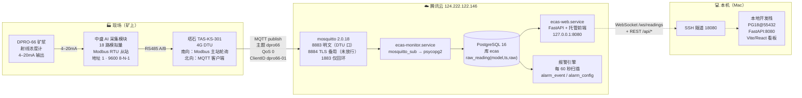

# ECAS 浓度计数据链路 · 部署与踩坑手册

> 一句话：**现场浓度计（4–20mA → RS485/Modbus）→ 塔石 4G DTU → MQTT → 腾讯云服务器 → PostgreSQL → FastAPI → 网页看板**，全链路已经把"从裸机到能看数据"跑通一遍；这份文档把**步骤、口径、坑**一次性写清楚，给后续开发（以及三个月后的自己）用。

> [!summary]- 30 秒速览
> - **数据在哪**：腾讯云 `124.222.122.146` 的 PostgreSQL 库 `ecas`，表 `raw_reading(model, ts, raw)` —— **只存原始值**，一切换算在后端。
> - **看板在哪**：云端 `127.0.0.1:8080`（ecas-web），**不对公网开放**，只能隧道访问：`ssh -o ControlMaster=no -f -N -L 18080:127.0.0.1:8080 ecas`，然后开 `http://127.0.0.1:18080/`。
> - **令牌在哪**：`ssh ecas 'grep ECAS_AUTH_TOKEN /root/ecas-web/ecas-web.env'`（也可用 `?token=xxx` 直链，前端会自动存下并抹掉地址栏）。
> - **换算口径**：`浓度 = (raw − 4000) ÷ 160 + 0.48`（09-26 15:40 现场 7 点比对标定；此前为 +0.3）；`raw < 3600` 断线、`raw > 20500` 超量程。
> - **改口径只改一处**：本地 `web/backend/app/settings.py`（云端用 `ecas-web.env` 覆盖），前端只负责显示。

> [!tip] 我要做什么 → 看哪节
> | 我要… | 去 |
> | --- | --- |
> | 搞清一条数据怎么变成浓度 | [[#2. 数据口径（改算法前必读）]] |
> | 现场接浓度计 / 配 DTU | [[#3. 现场侧：浓度计 + RS485 + DTU]] |
> | 换服务器 / 重新部署云端 | [[#4. 云端部署（裸机 → 可用）]] |
> | 查端口、加固、TLS | [[#5. 云端安全加固]] |
> | 在本机改代码、看效果 | [[#6. 本地开发栈（Mac）]] |
> | 查接口 / 报警 / 导出 | [[#7. 应用层：接口、鉴权、报警]] |
> | **遇到报错先来这** | [[#8. 踩坑总表]] |
> | 忘了命令 | [[#9. 常用命令速查]] |
> | 出事要退回去 | [[#10. 回滚手册]] |
> | 想知道"为什么这么定" | [[#11. 关键决策记录（ADR）]] |

> [!info] 关联文档
> - [[485仪表接入SOP]] —— 现场侧超详细过程记录（约 1900 行，含大量原始报文与截图说明）
> - [[云端部署]] —— 云端部署与现状
> - [[服务器安全加固]] —— SSH / sshguard / 安全组 / TLS
> - [[本地开发环境]] —— Mac 侧完整搭建与验证证据
> - [[服务器根目录清单]] —— `/root` 下每个文件是干什么的
> - [[采集端对接说明]] —— 采集端（DTU/平台）对接口径

---

## 1. 系统全貌

### 1.1 数据链路



**关键约束（先记住，能省很多时间）**：

1. **DTU 只发原始值整数**，不做任何换算 —— 换算是服务器的事（先生明确要求）。
2. **数据库只存原始值**（`model, ts, raw`），不存浓度 —— 这样才能"改算法不用回填历史"。
3. **报警判据统一以 raw 阈值为准**，浓度只是显示形式 —— 保证"扫描事件 / 汇总越限数 / 图表阈值线"三处**逐位一致**。
4. **看板不对公网开放**（8080 不在安全组、服务只绑 `127.0.0.1`），这是刻意设计。

### 1.2 地址与端口总表

| 位置 | 端口 | 服务 | 公网可达 | 说明 |
| --- | --- | --- | --- | --- |
| 云 | 22 TCP | sshd | ✅ 安全组放行 | **只认密钥**（`PasswordAuthentication no`）+ sshguard |
| 云 | 1883 TCP | mosquitto 明文 | ❌ **仅 `127.0.0.1`** | 2026-09-26 15:19 收口，只给本机 `ecas-monitor` 订阅。安全组那条规则可删 |
| 云 | 8883 TCP | mosquitto **明文** | ✅ 已放行 | **现场 DTU 口**：塔石 DTU 实测只会发明文 MQTT（§8.5），安全靠认证 + 主题 ACL + 最小权限 + 冒名检测 |
| 云 | 8884 TCP | mosquitto TLS | ❌ 未放行 | **备用**：将来有 TLS 能力的设备直接可用（参数已配好，只需安全组放行 + 把 DTU 指过来） |
| 云 | 5432 TCP | PostgreSQL | ❌ 只绑 `127.0.0.1` | `scram-sha-256`（TCP），本地 socket 走 `peer` |
| 云 | 8080 TCP | ecas-web（FastAPI） | ❌ 只绑 `127.0.0.1` | 走 SSH 隧道访问；需访问令牌 |
| 云 | 8888 TCP | BT-Panel 宝塔 | ⛔ 已在安全组拒绝 | 要用就隧道 `ssh -L 8888:127.0.0.1:8888 ecas` |
| 云 | 80 / 443 / 11012 | **无进程监听** | ⛔ 已拒绝 | 80/443 已关；**11012 遗留放行，建议删** |
| 云 | 11010 / 11011 / 12121 / 21212 | easytier（先生另一项目） | ✅ v4 放行 | ⚠️ **不要动** |
| 本机 | 55432 | PostgreSQL 18（brew） | 本机 | 5432 被 Hindsight 的 PG 占着，**别碰** |
| 本机 | 8080 | 本地 FastAPI | 本机 | 与云端 8080 同名不同机，隧道因此用 18080 |
| 本机 | 5173 | Vite dev server | 本机 | 开发时用；proxy → 8080 |

> [!warning] 公网可达性由**腾讯云安全组**决定，不是服务器自己的 iptables
> 服务器上的 iptables 里没有业务端口的拦截规则（只有腾讯云镜 `YJ-FIREWALL-INPUT` 和 docker 链）。要开/关公网端口，**去腾讯云控制台改安全组**。
> ⚠️ **绝对不要给 22 端口做来源 IP 限制**：OrcaTerm（腾讯云网页终端）不走 sshd、入口 IP 不确定，锁错就只能去控制台 VNC 救场。

### 1.3 组件与版本

| 组件 | 版本 | 位置 | 备注 |
| --- | --- | --- | --- |
| 腾讯云轻量 | OpenCloudOS 9.4，4 GB RAM | `124.222.122.146` / `VM-0-13-opencloudos` | 无 docker |
| PostgreSQL | 16.15 | 云 `/var/lib/pgsql/data` | 单库 `ecas`，role `ecas` |
| mosquitto | 2.0.18-4.oc9 | 云（EPOL 源装） | OpenSSL 3.0.12 |
| sshguard | 2.4.2-2.oc9 | 云（EPOL 源） | 取代 fail2ban（本发行版没有） |
| Python（云） | 3.11.6 系统 + uv 自管 3.13 | `/root/.local/bin/uv` 0.12.19 | 后端跑在 uv 的 3.13 上 |
| FastAPI | 0.141.1 | 云 `/root/ecas-web/backend`、本机 `web/backend` | 含 uvicorn 0.54.0 |
| psycopg | 3.3.6（+ pool 3.3.3） | 后端 | `row_factory=dict_row` |
| pydantic / settings | 2.13.5 / 2.15.0 | 后端 | `env_prefix="ECAS_"` |
| 前端 | Vite 8 + React 19 + TS 6 + recharts 3 | `web/frontend` | `pnpm build` → 后端 StaticFiles 托管 |
| PostgreSQL（本机） | 18.6（brew） | `/opt/homebrew/var/postgresql@18` | 端口改 55432 |
| Python（本机） | 3.14.7 系统 / uv 自管 3.13 | `web/backend/.venv` | uv 0.12.7 |

### 1.4 文件地图

**云端 `/root`（详见 [[服务器根目录清单]]）**

```text
/root
├── ecas/                          # ECAS 项目云上工作区
│   ├── app/api.py                 # 旧版单文件 API（已停用，单元保留可回滚）
│   ├── scripts/                   # monitor-service.sh 等
│   ├── credentials/mqtt-pass.cred # systemd 加密凭据（MQTT 口令）
│   └── archive/                   # 备份：sshd_config、db/*.dump 等
├── ecas-web/                      # 新版部署目录（部署脚本的 rsync 目标）
│   ├── backend/                   # = 仓库 web/backend（含 .venv）
│   ├── frontend/dist/             # = 仓库 web/frontend/dist
│   └── ecas-web.env               # 600，ECAS_* 环境变量（含访问令牌）
├── .pgpass                        # 600，PG 凭据
├── dpro66_monitor.sh              # ⚠️ 已不存在（迁到 ecas/scripts/）
├── deploy-mqtt.sh / 1ms-helper    # 早前环境准备脚本（1ms-helper 是配 docker 镜像用的）
└── .ssh/authorized_keys           # root 只有 1 把 ED25519 公钥
```

**本机仓库（`/Users/lijc/source/qt/ecas`）**

```text
ecas/
├── scripts/485/                   # 现场侧脚本
│   ├── app/{config,convert,api}.py        # 旧版单文件 API 的逻辑
│   ├── dpro66_monitor.sh                  # 采集主脚本（MQTT→DB）
│   ├── check_night.sh / test_*.sh         # 巡检与自测脚本
│   ├── setup_mqtt_auth.sh / test_mqtt_auth.sh
│   ├── sql/{001_init,002_queries}.sql
│   ├── dpro66_calculator.html             # ⭐ 现场离线换算器（单文件、零依赖）
│   └── systemd/                           # 单元文件模板
├── web/                           # ⭐ 本地开发栈（不污染 CLion C++ 工程）
│   ├── backend/   (FastAPI + uv)
│   ├── frontend/  (Vite + React + TS)
│   ├── deploy/    (ecas-web.service / cloud.env.example / CA 证书副本)
│   ├── scripts/   (sync-from-cloud.sh / deploy-to-cloud.sh)
│   └── README.md
└── docs/                          # 本手册及同族文档
```

> [!note] 为什么把 web 栈放在 `web/` 子目录
> `ecas` 本身是一个 **CLion C++ 工作区**（阶段 0，六条铁律 + L1–L8 分层）。先生要求"本机先搭网页和数据库、验证没问题再发布，且合理安排、不要干扰 CLion"。所以：所有 Web 相关文件收在 `web/`，**不新增任何 CMakeLists**，依赖产物（`node_modules`/`.venv`/`dist`）全部写进 `.gitignore`；CLion 侧只需手动把这两个目录 **Mark Directory as → Excluded**。

---

## 2. 数据口径（改算法前必读）

### 2.1 4–20 mA → 浓度：一条直线

本质是**线性映射**：浓度 0~100 ↔ 电流 4~20 mA，两点定一线。

```text
斜率 = (100 − 0) ÷ (20 − 4) = 100 ÷ 16 = 6.25      # 每 1 mA = 6.25 个浓度点

浓度 = (mA − 4) × 6.25                              # 分步
浓度 = (raw − 4000) ÷ 160                           # 一步到位（raw 单位 = µA 计数）
mA   = raw ÷ 1000
```

通用式（量程可配）：

```text
浓度 = (电流 − I_lo) ÷ (I_hi − I_lo) × (C_hi − C_lo) + C_lo
```

**速查锚点**（每 +160 raw = +1 个浓度点）：

| raw | mA | 浓度 |
| --- | --- | --- |
| 4000 | 4.000 | 0.00 |
| 12000 | 12.000 | 50.00 |
| 20000 | 20.000 | 100.00 |
| 12935 | 12.935 | **55.844**（验算用例） |

> [!info] 分辨率不是误差来源
> raw 1 个计数 = 0.00625 个浓度点；12 位 AD 一步 = 20 mA / 4096 = 0.0049 mA ≈ **0.030 个浓度点**。分辨率比现场观察到的残差小 25 倍 ⇒ 残差来自**映射假设或某侧标定**，不要怪采集精度。

### 2.2 补偿：当前 **+0.48 个浓度点**（加法，不是乘法）

补偿值经过三轮现场标定，**只改一个数**：

| 时间 | 补偿 | 依据 |
| --- | --- | --- |
| 09-25 | `+0.5` | 万用表比对单点：换算 55.844 vs 浓度计 56.612 |
| 09-26 00:34 | `+0.3` | 先生定案：「实际浓度值 = 换算后的浓度值 + 0.3%」，按既有约定实现为**加性 0.3 个浓度点**（不是 ×1.003） |
| **09-26 15:40（现役）** | **`+0.48`** | 先生给 **7 组现场比对**（系统值已含 +0.3 时仍系统性偏低，见下） |

```text
浓度 = (raw − 4000) ÷ 160 + 0.48          # ⭐ 现役
```

> [!example]- 09-26 15:40 的标定数据与统计（点开看）
> | 系统采集值（含 +0.3） | 浓度计值 | 差 |
> | --- | --- | --- |
> | 55.294 | 55.486 | +0.192 |
> | 55.431 | 55.596 | +0.165 |
> | 55.338 | 55.514 | +0.176 |
> | 55.331 | 55.514 | +0.183 |
> | 55.375 | 55.569 | +0.194 |
> | 55.488 | 55.679 | +0.191 |
> | 55.456 | 55.624 | +0.168 |
>
> 差值**均值 +0.181**、σ=0.012、标准误 0.0045 ⇒ 新加性偏移 = 0.3 + 0.181 = **0.481，取 0.48**。
> 比值（浓度计/系统）均值 = **1.00327**（散度 0.0002）—— 正好落在先生最初说的「+0.3%」乘性口径上。
> ⚠️ **两种模型（加性 0.48 / 乘性 ×1.0033）在这组数据上不可区分**：x 只在 54.99~55.19 之间铺开 0.19，
> 拟合斜率 1.003 ± 0.066（误差比斜率本身大 20 倍）。要区分必须**再抓一组低浓度（~30）或高浓度（~80）的点**。

理由：现场偏差表现为**整体偏低一个常量**，加法最省事；真正修干净仍是**两点标定** `浓度 = a × raw + b`。

> [!tip] 补偿只有一处代码
> 后端 `web/backend/app/convert.py` 的 `apply_offset()` 是**唯一补偿点**；配置在 `settings.py`：
> `ECAS_OFFSET_MODE=add`（`add` 加 `offset_conc`；`mul` 乘 `(1 + offset_pct/100)`）、`ECAS_OFFSET_CONC=0.48`、`ECAS_OFFSET_PCT=0.3`。
> 云端由 `/root/ecas-web/ecas-web.env` 的 `ECAS_OFFSET_CONC=0.48` 覆盖。
> 因为库里只存 raw，**改补偿口径不需要回填任何历史数据**，改完 `systemctl restart ecas-web` 立即生效（历史数据同步"变"）。

> [!success] 改后复测（2026-09-26 16:0x，先生现场读数）
> 补偿改为 +0.48 后，先生再给 5 组比对（系统值 52.855/52.911/53.092/53.086/53.080 vs 浓度计 52.914/52.941/53.136/53.191/53.108）：
> 残差（浓度计 − 未补偿）= +0.539 / +0.510 / +0.524 / +0.585 / +0.508 ⇒ **均值 +0.053**、σ=0.032。
> 折成看板上的口径就是**偏差 0.028~0.105 个浓度点（≈读数的 0.1%）**，小于仪表自身精度与人工视线读数误差 ⇒ 先生判定
> 「**精度差不多达标，数据采集合格了**」，补偿**保持 0.48 不动**（不去追逐这 0.05 的残差）。
>
> ⚠️ 一句留给后来的自己的话：两组点算出的「应有偏移」并不相同（15:40 组 0.481、16:0x 组 0.533，差 0.052，t≈3.5）——
> 这**可能**是真实的增益差（两点拟出的 `a = 0.980 ± 0.006`），也**可能**只是人工读数的**时移假象**：浓度在下行趋势里，
> 仪表读数与所比对的看板行差几十秒就会造出这种系统偏差（16:0x 那组的 σ 是 15:40 组的 2.6 倍，正是时移变大的信号）。
> 两组只覆盖 52.5~55.1，**无法分辨增益**。要真正定案，只需**跨度两点标定**（低浓度 ~30 / 高浓度 ~80 各取一组）。

> [!warning] 改补偿必然连带改报警反解
> 报警阈值是**浓度**、判定走 **raw**，所以 `offset_conc` 一动，`low_raw/high_raw` 跟着动：
> 40 从 10352 → **10323**，60 从 13552 → **13523**。测试里这两处是写死的，改补偿时**必须同步改测试**（见 §2.4）。

### 2.3 状态判定（NAMUR NE43 思路）

| 状态 | 判据 | 含义 | 显示 |
| --- | --- | --- | --- |
| 断线 | `raw < 3600`（< 3.6 mA） | 断线 / 仪表故障 | **红色，不显示浓度** |
| 偏低 | `3600 ≤ raw < 4000` | 低于活零 | 黄色，浓度不可信 |
| 正常 | `4000 ≤ raw ≤ 20500` | 4–20 mA 区间内 | 正常显示 |
| 超量程 | `raw > 20500`（> 20.5 mA） | 超量程 | 标记不可信 |

> [!warning] 活零（live zero）—— 现场必须懂的一条
> **4 mA 代表"测得的浓度 = 0"**，而不是"没有信号"；**0 mA 才是断线/故障**。所以看到 raw 掉到 0 附近，先当断线处理，**不要当"浓度为负"**。

### 2.4 报警阈值 ↔ raw 反解

报警阈值用**浓度**配置（人看得懂），判定用 **raw**（机器精确）。反解公式：

```text
raw = 4000 + (浓度 − 0.48) × 160          # ⭐ 现役补偿 0.48
```

| 浓度阈值 | 对应 raw（+0.48） |
| --- | --- |
| 40.0（出厂下限） | **10323** |
| 45.0 | 11123 |
| 50.0 | 11923 |
| 52.0 | 12243 |
| 55.0 | 12723 |
| 58.0 | 13203 |
| 60.0（出厂上限） | **13523** |

> [!bug] 手算 10384 / 13584 是**错的**（忘了减补偿）
> 那是 +0.3 时代的错误手算；+0.3 时的正确值是 10352 / 13552，**+0.48 时是 10323 / 13523**。
> 这个错被单元测试（`test_export.py` 的"报警反解互逆"用例）逮住 —— **反解只写一处、并用测试锁住**，就是为防这类手算漂移。

### 2.5 单一事实来源

| 事实 | 唯一来源 | 谁消费 |
| --- | --- | --- |
| 量程 / 补偿 / 断线超量程阈值 | `settings.py`（云端 `ecas-web.env`） | 后端 `convert.py` |
| 报警阈值（浓度） | 数据库表 `alarm_config`（可在看板改） | 后端 `alarms.py` + 前端 |
| 报警阈值（raw） | 运行时由 `convert.conc_to_raw()` 反解 | 报警扫描 / 汇总越限数 / 图表线 |
| 每个值的显示格式 | 前端 `api.ts` 的 `fmtNum` 等 | 看板 |

> [!danger] 改口径时最容易犯的错
> 在三个地方各写一份换算（后端、DTU 配置、前端）⇒ 三份慢慢漂移。**已经统一为后端一份**；DTU 只发原始值，前端只显示后端算好的值。

---

## 3. 现场侧：浓度计 + RS485 + DTU

### 3.1 从零接入步骤

1. **接线**：浓度计 4–20 mA → 采集模块对应通道；采集模块 A/B → DTU 的 A/B（**A→A、B→B**，并联）；DTU 供 9~24 V、插 4G 卡 + 天线。
2. ⛔ **拔掉 PC 的 USB-485**：RS485 是单主站总线，中盛调试软件和 DTU 都是主站，同时轮询会撞帧。
3. **串口参数逐项对齐**：`9600 / 8 / N / 1`（无校验）。
4. **DTU 模式 = Modbus 轮询（主站）**，⚠️ **不是透传模式**（透传只转发不采集）。
5. **填轮询指令**：`01040000000131CA`（读 CH1 输入寄存器；带 CRC、手填）。
6. **轮询周期 5~10 秒**（100 ms 对浓度计毫无价值，见 §8.1）。
7. **配北向 MQTT**（服务器地址、端口、ClientID、账号口令、推送主题、QoS）—— 见下表。
8. **验收**：在服务器 `mosquitto_sub -h 127.0.0.1 -t dpro66 -v` 能看到报文，且 raw ≈ **12935**。

### 3.2 DTU 参数表（TAS-KS-301）

| 项 | 值 |
| --- | --- |
| 南向轮询 | 打开；指令 `01040000000131CA`；周期 5~10 s |
| 串口 | 9600 / 8-N-1 |
| 北向 | MQTT |
| 服务器地址 | `124.222.122.146`（或域名） |
| 端口 | **8883**（明文口，DTU 当前使用；⚠️ 别填 1883 —— 那是只绑回环的本机口；8884 是未放行的 TLS 备用口） |
| ClientID | `dpro66-01` |
| 用户名 / 口令 | `ecas` / `<见 /etc/mosquitto/passwd，勿写进仓库>` |
| 推送主题 | **`dpro66`**（单级、最短、纯 ASCII） |
| QoS | 建议 **1**（现为 0，见坑） |
| keepalive | 60 s |

> [!tip] 改主题要同时改三处
> ① DTU 网页 → 通道-1 → 北向接口 → **推送主题1**；② 服务器订阅命令/脚本；③ 脚本 `--topic` 默认值。
> 换主题前清掉旧主题上的保留消息：`mosquitto_pub -h 127.0.0.1 -p 1883 -t '<旧主题>' -r -n`

### 3.3 Modbus 寄存器表（18 路输入寄存器）

| 通道 | 地址 | 通道 | 地址 |
| --- | --- | --- | --- |
| CH1 | `0000H` | CH10 | `0009H` |
| CH2 | `0001H` | CH11 | `000AH` |
| … | … | … | … |
| CH9 | `0008H` | CH18 | `0011H` |

回帧格式：`01 04 02 xx xx CRC`，**原始值 = 第 4、5 字节按大端拼接**（`high × 256 + low`）；平台数据类型建 **uint16 / Word 大端 AB**，⛔ 别建 float。

### 3.4 现场验收判据

| 现象 | 结论 |
| --- | --- |
| 收到 `01 04 02 33 87 …`（≈12935） | ✅ 正确 |
| 收到 `01 04 02 87 33 …`（≈13332 之类字节序颠倒） | 字节序配错 |
| **有"收"但值恒为 0** | **地址/通道错了**（不是链路问题） |
| **连"收"都没有** | 链路问题 / 功能码不被支持 |
| 一直是 65535 | 模块没应答 |

> [!example]- 现场换算器（离线单文件）
> `scripts/485/dpro66_calculator.html`（16 179 B，零依赖，双击浏览器打开）：
> - 手输 raw → 出 mA / 浓度 / 12 位 AD 计数
> - **粘报文** → 自动 CRC 校验 + 列全部 18 路 + 自动取有电流那一路
> - `findFrame()` 滑窗按 CRC 搜真帧，容忍时间戳前缀、连粘两帧、杂质字节
> - 量程参数可调；两点标定反解 `浓度 = a × raw + b`
> ⚠️ 投递/引用时**必须用绝对路径**，相对路径会被解析成 `/scripts/485/...` 报 ENOENT。

### 3.5 现场踩坑

> [!bug] 手册里的"旧指令"读的是 CH10，不是 CH1
> `01 04 00 09 00 01 E1 C8` 的起始地址 `0009H` = **通道 10**。CH10 没接线 ⇒ 恒为 0 ⇒ 现象上等同"读不到"，白绕很久。
> **教训：别把手册示例地址当"通道 1 的地址"；有"收"但值为 0 = 地址错。**

> [!bug] 中盛调试助手的问题
> - 之前发过 `01 01 00 00 00 01 FD CA`（CRC 正确）—— 那是 **01H 读线圈**（开关量），功能码选错了；读电流要用 **04H 输入寄存器**。
> - 调试助手显示的是**原始值**，不自动换算 mA。
> - 定位寄存器三招：① 查表 ② 整块读 `01 04 00 00 00 12 70 07`，看哪个是一万多 ③ **扰动法**（拔线，哪个掉 0 就是哪个）。

> [!bug] 轮询周期设成 100 ms
> 浓度 100 分钟才涨约 1.5 个点，100 ms 毫无价值；且 9600 bps 下一次完整 Modbus 问答约 150~185 bit ≈ **19 ms**，100 ms 周期只剩不到 5 倍余量，容易积压/丢帧。**用 5~10 s。**

---

## 4. 云端部署（裸机 → 可用）

### 4.1 前置

- 有一台能 SSH 的服务器（本项目：腾讯云轻量 OpenCloudOS 9.4）。
- 本机 `~/.ssh/config` 里有别名（免密）：

```sshconfig
Host ecas
    HostName 124.222.122.146
    User root
    Port 22
    ServerAliveInterval 30
    ServerAliveCountMax 3
    IdentityFile ~/.ssh/id_ed25519
```

- 已验证：`ssh -o BatchMode=yes ecas 'echo OK; hostname; id -un'` → `OK / VM-0-13-opencloudos / root`。

### 4.2 部署步骤（12 步）

> [!example]- 展开：完整命令（按顺序，幂等可重跑）
> ```bash
> # ① 装 mosquitto（OpenCloudOS 需要 EPOL 源）
> dnf install -y epol-release && dnf install -y mosquitto
>
> # ② 初始化 PostgreSQL：建 role + 库（注意 /root 是 700，别想直接 pg_restore 到 /root）
> sudo -u postgres psql -c "CREATE ROLE ecas LOGIN PASSWORD '<pw>';"
> sudo -u postgres psql -c "CREATE DATABASE ecas OWNER ecas;"
>
> # ③ 建表（最小 schema）
> PGPASSFILE=/root/.pgpass psql -h 127.0.0.1 -U ecas -d ecas -f sql/001_init.sql
>
> # ④ 写 /root/.pgpass（600；第三字段用 * 才匹配临时库）
> printf '127.0.0.1:*:ecas:<pw>\n' > /root/.pgpass && chmod 600 /root/.pgpass
>
> # ⑤ 配 mosquitto：追加 listener/认证到 /etc/mosquitto/mosquitto.conf
> #    注意 per_listener_settings 默认 false ⇒ allow_anonymous/password_file 对所有 listener 生效
>
> # ⑥ 建口令文件（⚠️ 属主必须是 mosquitto 用户，否则重启起不来）
> mosquitto_passwd -c -b /etc/mosquitto/passwd ecas '<pw>'
> chown mosquitto:mosquitto /etc/mosquitto/passwd && chmod 640 /etc/mosquitto/passwd
> systemctl restart mosquitto   # ⚠️ 必须真 restart 验证一次，SIGHUP 会掩盖权限问题
>
> # ⑦ 采集程序：MQTT → DB（systemd 单元 + 加密凭据）
> systemctl enable --now ecas-monitor.service
>
> # ⑧ 定时备份 + 健康检查
> systemctl enable --now ecas-pgdump.timer ecas-healthcheck.timer
>
> # ⑨ 部署新版 Web（FastAPI + 前端产物）
> web/scripts/deploy-to-cloud.sh          # 六步：检查 → build → rsync → uv sync → 装单元 → 自检
>
> # ⑩ 旧 API 让位（单元保留，可随时回滚）
> systemctl disable --now ecas-api.service
> systemctl enable --now ecas-web.service
>
> # ⑪ 安全加固（SSH 只认密钥 + sshguard）—— 见第 5 节
>
> # ⑫ MQTT TLS 8883（服务端就绪；等 DTU 支持）—— 见 5.5
> ```

### 4.3 部署脚本 `web/scripts/deploy-to-cloud.sh`

六步，可重复执行（幂等）：

1. 前置检查（`ecas-web.env` 存在、`uv` 可用）
2. `pnpm build`（`--no-build` 可跳过）
3. `rsync` 后端 → `/root/ecas-web/backend/`
4. `rsync` 前端 `dist/` → `/root/ecas-web/frontend/dist/`
5. `uv sync --frozen --no-dev`
6. 装单元 + `daemon-reload` + `enable --now` + `restart` + `is-active`，然后自检 `/healthz`、`/api/auth`、无令牌 401、首页状态码

> [!danger] rsync 必须带 `-e 'ssh -o ControlMaster=no'`
> 否则在本机沙箱里报 `unix_listener: cannot bind to path /Users/lijc/.ssh/controlmasters/...: Operation not permitted`。
> 另外：`main.py` 里 `DIST_DIR = Path(__file__).resolve().parents[2] / "frontend" / "dist"` ⇒ **`backend/` 与 `frontend/` 必须同级**。

### 4.4 验证清单（部署完必须逐条过）

| 检查 | 期望 |
| --- | --- |
| `curl -s localhost:8080/healthz` | `ok` |
| `/api/auth` | `{"service":"ecas-backend","auth_required":true}` |
| `/api/health`（不带令牌） | **401** + `WWW-Authenticate: Bearer` |
| `/api/health`（带令牌） | `stale false`，`rows_total` 在增长 |
| `/api/alarms` | `scan` 无 `error`，`n_rows` > 0 |
| `systemctl is-active ecas-web ecas-monitor mosquitto postgresql` | 全 `active` |
| 数据库最新一行 | `ts` 在最近 5 分钟内 |

---

## 5. 云端安全加固

> 详细过程与证据见 [[服务器安全加固]]。

### 5.1 SSH：只认密钥

`/etc/ssh/sshd_config.d/05-ecas-hardening.conf`（600）：

```sshconfig
PermitRootLogin prohibit-password
PasswordAuthentication no
KbdInteractiveAuthentication no
AllowUsers root
MaxAuthTries 3
LoginGraceTime 30
GSSAPIAuthentication no
```

> [!warning] 命名 `05-` 不是随便取的
> - `Include /etc/ssh/sshd_config.d/*.conf` 在 `sshd_config:15`，且 **sshd 是"先出现者生效"**；
> - `50-cloud-init.conf` 里写着 `PasswordAuthentication yes`；
> - 所以加固文件必须**排在它前面**（`05-`），否则不生效。
> 复核命令：`sshd -T | grep -E 'permitrootlogin|passwordauthentication|maxauthtries'`

> [!tip] 改 SSH 配置一定要挂"自动回滚保险"
> 怕改坏了没人能进 —— 用 systemd 定时器兜底：
> ```bash
> systemd-run --on-active=120 --unit=ssh-hardening-rollback --collect \
>   /bin/bash -c 'rm -f /etc/ssh/sshd_config.d/05-ecas-hardening.conf && systemctl reload sshd'
> systemctl reload sshd
> # 新开一个连接验证能进：
> ssh -o BatchMode=yes ecas 'echo KEY_AUTH_OK'
> # 能进就取消保险：
> systemctl stop ssh-hardening-rollback.timer
> ```

> [!info] 为什么不怕把自己锁在外面
> **OrcaTerm（腾讯云网页终端）不走 sshd**：它的父进程不是 sshd，命令是 `bash --noprofile --rcfile /root/.orca_term/bash-integration.sh`。所以改 sshd 只影响 SSH 登录；最坏情况还有**控制台 VNC**（用实例口令）兜底。

### 5.2 sshguard（替代 fail2ban）

OpenCloudOS 各仓库**都没有 fail2ban**，也没有 firewalld / iptables-services；EPOL 里有 **`sshguard 2.4.2`**。

```bash
dnf install -y sshguard
# /etc/sshguard.conf：后端改成 iptables（本机没装 firewalld）
BACKEND="/usr/libexec/sshguard/sshg-fw-iptables"
# /etc/sshguard.whitelist：放行回环
127.0.0.0/8
::1/128
systemctl enable --now sshguard
```

> [!bug] sshguard 的 iptables 后端**不会自己建链**
> 该后端从 **stdin** 读命令、用 `-I sshguard ...` 加规则；而 `fw_init` 只执行 `iptables -L -n`，**不会创建 `sshguard` 链** ⇒ 不先建链，封禁时报：
> `iptables: No chain/target/match by that name.`
> 处置：单元 drop-in `/etc/systemd/system/sshguard.service.d/10-ecas-chain.conf` 里用 `-C || -I` 幂等地建链 + 挂跳转（IPv4/IPv6 各两行），避免每次 `restart` 多加一条重复跳转。

> [!note] 一个虚惊
> `iptables -S | grep -c 'dport 22 .*-j REJECT'` 有 **674** 条 —— 那是**腾讯云镜 `YJ-FIREWALL-INPUT` 的封禁表**，不是 sshguard 加的。总规则数 841 一直没变。

### 5.3 腾讯云安全组

见 [[#1.2 地址与端口总表]]。要做的事：

- [x] 关闭 8888（宝塔）、80、443
- [ ] **删掉 11012（TCP+UDP）遗留放行**（机器上没有进程监听）
- [ ] 若要收口宝塔：`ssh -L 8888:127.0.0.1:8888 ecas` 隧道访问（推荐），而不是开公网
- [ ] ⚠️ **不要**给 22 做来源 IP 限制

### 5.4 mosquitto 认证与主题 ACL（2026-09-26 已收紧）

| 项 | 现状 |
| --- | --- |
| `allow_anonymous` | **false**（09-25 23:25 完成，非"裸奔"） |
| `password_file` | `/etc/mosquitto/passwd`（**`root:mosquitto 640`** —— root 属主满足 `mosquitto_passwd` 的未来要求，组 mosquitto 保证降权后 broker 读得到） |
| `acl_file` | ✅ `/etc/mosquitto/acl.conf`（**默认拒绝**） |
| 本机口 | `listener 1883 127.0.0.1`（**仅回环**，只给本机采集器；2026-09-26 15:19 收口） |
| DTU 口 | `listener 8883`（**0.0.0.0，明文** —— 塔石 DTU 只会发明文，2026-09-26 15:22 抓包坐实） |
| TLS 备用口 | `listener 8884`（0.0.0.0 + cafile/certfile/keyfile，**安全组未放行**） |

三个账号（口令在服务器 `/root/ecas/credentials/mqtt-accounts-20260926.txt`，600，**抄进加密卷后 `shred`**）：

| 账号 | 权限 | 用途 |
| --- | --- | --- |
| `ecas` | `read dpro66` + `write dpro66` | 管理 / 应急 |
| `dpro66-dtu` | `write dpro66` | 现场 DTU（只能发） |
| `ecas-monitor` | `read dpro66` | 采集器（只能听） |

一条命令落地/查状态：`scripts/485/setup_mqtt_acl.sh`（`--show` / `--dry-run` / `-y` / `--secrets-out FILE` / `--rotate`）。

> [!warning] 凭据清单要对得上（2026-09-26 15:05 实测，15:07 已闭环）
> 用「拿加密卷里的值真连一次」的方式核对三个账号，结果：
> - ✅ `username=dpro66-dtu` ＋ `password` → 认证通过（现场 DTU 现役）；
> - ✅ `monitor_username=ecas-monitor` ＋ `monitor_password` → 认证通过（与服务器 `mqtt-pass.cred` 解出的值一致）；
> - ❌ `password_back`（指纹 `96998b77dcff`，跟文件头写的一样）→ **三个账号都登不上**，是改口令前的旧值；
> - ❌ **管理账号 `ecas` 的现役口令不在卷里**（hash 在 09-25 23:43→00:27 被改过）。目前没有服务依赖它，属"应急账号"。
>   🔎 补查（把三份加密 `.cred` 都解出来真连）：`ecas` 口令**还在服务器上** ——
>   `/root/ecas/credentials/mqtt-pass.cred.bak-20260926-144406` 指纹 `6edc88b947f4` 能登 `ecas`（✅），
>  而 `old-round4` 的指纹 `96998b77dcff` 与卷里 `password_back` 一致、三个账号都登不上 ⇒ 那是第四轮**已轮换**的旧口令。
>  ⚠️ 所以**别急着 shred 那份 `.bak`**：它当时同时是"旧凭据"和"`ecas` 口令的唯一副本"。
>
> ✅ **闭环（15:07，先生「按建议处理」）**：`ecas` 用 `mosquitto_passwd` 以 **stdin 方式**重设为 32 位随机口令
> （指纹 **`52be21d25462`**，旧口令实测 `rc=5` 已失效），新口令已写进加密卷的新键
> `admin_username` / `admin_password`（卷备份 `mqtt.toml.bak-20260926-150805`）；
> 随后「拿卷里的值真连」复验：`admin ✅ / dtu ✅ / monitor ✅ / password_back ❌`，与卷里记录完全一致；
> 最后才 `shred -uz` 那两份陈旧 `.cred`（`/root/ecas/credentials/` 只剩现役 `mqtt-pass.cred`）。
>
> ⚠️ **2026-09-26 17:40 更正：上面这次「已写进加密卷的新键」其实没落盘** —— 卷里从未出现
> `admin_username`/`admin_password`，服务器暂存文件也没留 ⇒ **指纹 `52be21d25462` 的值丢失**（只剩 passwd 哈希）。
> 17:33 / 17:36 重新轮换并**真正写卷 + 回读指纹核对**：`ecas-monitor` = `5254449f050c`、`ecas` = `146ef7a1bd7c`
> （`ecas-monitor` 新口令 `rc=0`、旧值 `rc=5`；`ecas` 新口令 `rc=0`）；卷内 `README.md` 指纹表与轮换史同步更正。
> 另修 `/etc/mosquitto/passwd` 属主 = `mosquitto:mosquitto 640`（broker 日志自己的要求）。
> 🎓 **追加教训：「写进权威副本」的完成判据是"回读并比对指纹"，不是"声称写完"**。
> 🎓 顺序教训：**先确认新口令落进权威副本并复验通过，再删旧副本** —— 反过来就会把唯一的应急账号口令删掉。
>
> ⚠️ 这种核对**必然产生 `not authorised`**：先 `systemctl stop ecas-mqtt-watch.timer`，核完把
> `mqtt-watch.state` 的 `off` prime 到日志末尾再 `start`，否则会留下"有人在试口令"的假事件（第二轮我漏了，15:04:53 那条就是我自己造的）。
> 另外：`scripts/485/test_db_insert.sh` 与 `scripts/485/start-monitor.sh` 的默认账号已分别改成 `dpro66-dtu` / `ecas-monitor`，别再让辅助脚本依赖 `ecas`。

> [!tip] 减损四件事已全部落地（DTU 上不了 TLS 时的兜底）
> 1. ✅ **主题 ACL**（默认拒绝，见上表）；
> 2. ✅ **两个最小权限账号** + 采集器已切到只读 `ecas-monitor`；
> 3. ✅ **冒名检测** `scripts/485/mqtt_watch.sh`（timer 每 2 分钟，事件进 `health.log` 与 `/root/ecas/logs/mqtt-watch.jsonl`）；
> 4. ✅ **QoS1 去重**（10 秒窗口，防重传重复行）。
> 风险量级说明：4G 链路上被动嗅探门槛很高；**更现实的风险是口令泄漏后有人冒充 DTU 发假数据**，所以重点是"能发现被冒名"，不是"防止被偷看"。
> 还有一个必须知道的实证：加固前裸奔的 1883 **真的被境外扫过**（`go`@5.252.83.218、`iw-76e052`@69.5.169.10、`MqttClient`@65.49.1.52）。

### 5.5 MQTT over TLS（8883）

**服务端已就绪**：

| 文件 | 说明 |
| --- | --- |
| `/etc/mosquitto/certs/ca.crt` | 自签根 CA，`CN=ECAS-MQTT-CA`，RSA 4096，10 年 |
| `/etc/mosquitto/certs/ca.key` | 640，**绝不外发** |
| `/etc/mosquitto/certs/server.crt` | `CN=124.222.122.146`，SAN = `IP:124.222.122.146, IP:127.0.0.1, DNS:VM-0-13-opencloudos` |
| `/etc/mosquitto/certs/server.key` | 640 |
| 仓库副本 | `web/deploy/ecas-mqtt-ca.crt`（sha256 `9a838474…`），给 DTU 上传用 |

配置（追加在 `mosquitto.conf` 尾部）：

```conf
# ==== ECAS 浓度计 MQTT over TLS（09-26 追加）====
listener 8883
cafile   /etc/mosquitto/certs/ca.crt
certfile /etc/mosquitto/certs/server.crt
keyfile  /etc/mosquitto/certs/server.key
tls_version tlsv1.2
```

**验证证据**（全部通过）：

- 监听 `0.0.0.0:1883` + `0.0.0.0:8883` 同时存在
- `mosquitto_pub` 走 8883 + `--cafile ca.crt` + 账号 → 订阅端收到 `TLS-OK-…` ✅
- 反例：明文连 8883 → `Error: Protocol error`；TLS 不带账号 → `Connection Refused: not authorised.`

> [!danger] 两个把服务搞挂过的坑（务必看完）
> **① `password_file` 属主不对 ⇒ 真 restart 才炸**
> 现象：`systemctl restart mosquitto` 失败，`status=13`，日志 `Error: Unable to open pwfile "/etc/mosquitto/passwd".`
> 根因：文件是 `root:root 600`，而 mosquitto 以 root 启动后**降权到 mosquitto 用户**再读；此前一直没炸是因为改配置只用了 `SIGHUP` 热加载（进程仍以 root 持有 fd）。
> 处置：`chown mosquitto:mosquitto /etc/mosquitto/passwd && chmod 640`，`systemctl reset-failed mosquitto && systemctl start mosquitto`。
> **代价**：broker 停 10:53:43 → 10:57:15（DTU 重连慢），**丢约 2 条数据**（QoS 0 永久丢失）。
> **教训：改 MQTT 配置后必须真 `systemctl restart` 验一次。**
>
> **② 证书 SAN 缺 `127.0.0.1` ⇒ 本机自测过不了主机名校验**
> 现象：`Error: host name verification failed.` + broker 侧 `tlsv1 alert internal error`。
> 处置：用同一把 key 重签 `server.crt`，SAN 里补 `IP:127.0.0.1`，然后 `systemctl reload mosquitto`（SIGHUP，不断开现有连接）。
>
> **③ `SSL routines::wrong version number` ⇒ 客户端拿着 TLS 去连了明文端口**（2026-09-26 15:17 现场踩到）
> 现象：broker 每 3 秒一条 `Client connection from 180.108.106.59 failed: error:0A00010B:SSL routines::wrong version number.`
> 根因：DTU 侧**开了 SSL，但端口那一栏还写着 1883**（1883 是明文口，收到 TLS ClientHello 自然"版本号不对"）。
> 处置：**把 DTU 里的端口改成 8883**，SSL 开关保持开启。⚠️ 这个报错**与证书无关**，别往证书方向查。
>
> **④ `listener` 的绑定地址改动不能被 SIGHUP 热加载**（2026-09-26 15:19）
> 把 `listener 1883` 改成 `listener 1883 127.0.0.1` 时，`reload`（SIGHUP）**不生效**，必须 `systemctl restart mosquitto`
> —— 代价是现有连接短暂断开（本机采集器会自动重连，DTU 也会）。改完必须用 `ss -ltn` 眼见为实，别假设它生效了。

> [!warning] 卡点：DTU 侧疑似不支持 TLS
> 塔石官网产品页与塔石云配置案例**都没有任何 SSL/TLS 说明**（配置项在文档里全是图片）。**TLS 是端到端的，最后一段只取决于 DTU 会不会说 TLS** —— 服务器这边再改也替不了它。
> 三条路径（详见 [[服务器安全加固]] §7.5）：
> - **A 问塔石**：MQTTS 支持吗？不支持的话 **TCP 透传是否支持 SSL**？（若支持，可让 DTU 走 `TCP+SSL`，服务器侧写"TLS + Modbus 主站"接收端，全链路加密）
> - **B 让塔石云中转**：DTU → 塔石云 → 我们（用 8883/HTTPS 收），需问转发是否支持 MQTTS/HTTPS 输出、是否收费
> - **C 明文 + 减损**：见 §5.4 的四件事（**✅ 已全部落地**）

> [!failure] ✅ 已定论（2026-09-26 15:22）：DTU 侧**无法** TLS —— 走 C
> **决定性的判据是抓包**（只盯日志会绕圈）：`tcpdump -i any -nn -A -c 6 "tcp port 8883 and (tcp[13] & 8 != 0)"`
> 抓到 DTU 在 8883 上发的是**明文 MQTT CONNECT**（`...MQTT...<.  dpro66-01.  dpro66-dtu.  <口令>` —— 用户名口令全裸）。
> 配合先生反馈的「塔石配置软件无法上传 CA 证书」，结论：**当前固件/工具只能明文**。
>
> **最终端口布局**：
> | 监听 | 协议 | 给谁 | 公网 |
> | --- | --- | --- | --- |
> | `127.0.0.1:1883` | 明文 | 本机采集器 `ecas-monitor` | ❌ 仅回环 |
> | `0.0.0.0:8883` | **明文** | **现场 DTU**（它就是往这里发明文） | ✅ 已放行 |
> | `0.0.0.0:8884` | TLS | 备用：将来有 TLS 能力的设备（参数已配好） | ❌ **未放行** |
>
> 安全基线完全落在应用层（认证 + 主题 ACL + 最小权限账号 + QoS1 去重 + 冒名检测）。
> **诚实的边界**：DTU 的账号口令在 4G 链路上是明文可见的 —— 被动嗅探门槛高（要在运营商侧抓包），
> 现实风险是"口令泄漏后有人冒充"，这已由 ACL + 冒名检测覆盖。
> 若塔石日后给出支持 TLS 的固件/工具：**只需把 8883 与 8884 两块 listener 对调**，DTU 端口不用改。

### 5.6 冒名检测与看门狗（2026-09-26 已上线）

| 文件 | 作用 |
| --- | --- |
| `scripts/485/mqtt_watch.sh` | 增量扫 `mosquitto.log`，六条规则判冒名/异常 |
| `scripts/485/systemd/ecas-mqtt-watch.{service,timer}` | 每 2 分钟跑一次（oneshot） |
| `/root/ecas/state/mqtt-watch.state` | 扫描偏移 `off=` + 记住的 DTU 来源 IP |
| `/root/ecas/logs/mqtt-watch.jsonl` | 事件流（`ts/level/kind/detail/ip/client/user`） |
| `scripts/485/ecas_healthcheck.sh` | 指纹第 5 段 = 事件行数，有新事件就写 `health.log` |

六条规则：**匿名连接**（严重）、**未知账号**（严重）、**未知 ClientId**（警告，DTU 账号下连随机 UUID 也报）、
**DTU 来源 IP 变化**（**提示** — 2026-09-26 先生确认降级，因为 4G 重播号会常态换 IP）、
**口令失败激增**（一轮 ≥3，警告）、**协议错误**（提示）。

> [!important] 为什么要注意「来源 IP 变化」
> DTU 走 4G，**重播号会换 IP**（实测一天内 `180.108.106.13` → `.15` → `.58` → `.44`），所以只记录、**不能做 IP 白名单**。
> 因为每次都变属常态，2026-09-26 起这条降级为「提示」级（仍进事件流与 `health.log`，只是不再算警告）。

> [!warning] 一个必须知道的历史数字：**969 次认证失败是我们自己造成的**
> 2026-09-25 23:25 开启认证后，DTU 仍用旧口令，客户端 `dpro66-01` 每 3 秒重试一次，直到 00:27 才对齐
> ⇒ **53 分钟无数据**。另有三次境外匿名连接（`5.252.83.218` / `69.5.169.10` / `65.49.1.52`）发生在加固前
> ——裸奔的 1883 确实被扫到过。**改口令的顺序永远是：先服务器、后 DTU。**

### 5.7 Ubuntu Super Server 测试栈（2026-09-26 上线，A 方案 Docker Compose）

第二套运行环境：把「采集 → 后端 → 看板」搬到 **10.10.10.11（ubuntu-super，easytier mesh 内的生产机）** 上跑，
三个容器 + systemd 自启，**只绑 mesh 地址**，公网/办公网都到不了。

| 位置 | 内容 |
| --- | --- |
| 仓库 | `web/deploy/ubuntu/`（`deploy.sh` 子命令 `stage\|push\|creds\|build\|up\|check\|logs\|all`） |
| 目标机 | `/opt/ecas/`（`docker-compose.yml`、`.env`、`backend/`、`collector/`、`sql/`、`secrets/`、`frontend-dist/`、`systemd/`） |
| 凭据 | `/opt/ecas/credentials/{pg-password,auth-token,mqtt-pass}`（目录 700、文件 600 root）→ compose secret → 容器 `/run/secrets/*`；**目标机 systemd 249 没有 `systemd-creds`**，此机破例用 600 明文（先生同意，记在密钥卷 README + 审计 #284） |
| 数据 | `/data/ecas/pgdata`（44T 数据盘，不是系统盘） |
| 单元 | `ecas-stack.service`（`Type=oneshot` + `docker compose up -d`，已 `enable` + `active`） |
| 看板 | `http://10.10.10.11:18080`（**只能从 mesh 内访问**；`/healthz` 公开，`/api/*` 要 Bearer 令牌） |

关键取值：`OFFSET_CONC=0.48`、`MODEL_NAME=DPRO-66`、只读账号 `ecas-monitor`、`MQTT_TOPIC=dpro66`。
宿主端口 **18080**：这台机上 `0.0.0.0:8080` 已被生产容器 `side.base.apigateway` 占用（实测 bind 冲突）。

#### 5.7.1 数据通路：走腾讯云，**不走测试机自己的外网出口**

先生 2026-09-26 明确：「**不走 218.88.248.132（测试机本地出口），走腾讯云服务器出外网**」。而 8884 安全组**未放行**
（云端配置自己写着「未放行安全组 ⇒ 公网不可达，仅作就绪备用」）⇒ 采集器**走 easytier mesh 连云端的 mesh 地址**：
`MQTT_HOST=10.10.10.123`、`MQTT_PORT=8884`（目标机 `ip route get 10.10.10.123` = `dev tun0`，即经隧道到腾讯云）。因此：
- **不需要**在安全组放行 8884，也不需要把测试机的外网 IP 加白名单；
- MQTT 流量全程走 mesh（easytier overlay）+ TLS。

2026-09-26 追问确认（先生选）：**只有数据通路走云**；测试机的 apt / pip / docker 拉镜像**维持直连**国内镜像源
（不为这台生产机改默认路由、也不在云端加代理服务）。

> [!important] SAN 里没有 mesh 地址 ⇒ 用「链校验 + 指纹钉扎」替代主机名校验
> `server.crt` 的 SAN = `IP:124.222.122.146, IP:127.0.0.1, DNS:VM-0-13-opencloudos`，**没有 `10.10.10.123`**。
> 所以 `web/deploy/ubuntu/collector/mqtt_tls_feeder.py` 在给了 `--cert-sha256` 时：`CERT_REQUIRED` 保留 CA 链校验，
> **关掉 hostname 检查**，改用 `MQTT_CERT_SHA256` 比对对端 leaf 证书的 SHA-256；取不到或不符 ⇒ `CertPinError`，**拒绝订阅**（fail closed）。
>
> 当前指纹（2026-09-26 签发，有效期至 2036-09-23，序列号 `40DE409E…FE2B2`）：
> `B6:4B:8D:3A:37:E4:39:AA:61:0B:BD:02:D1:9C:66:0D:EB:4C:11:CD:C8:77:DE:93:1C:AE:0E:72:5D:84:6D:41`
> 取法：`ssh ecas 'openssl x509 -in /etc/mosquitto/certs/server.crt -noout -fingerprint -sha256'`。
> 云端**若重签 `server.crt`（例如给 SAN 加 mesh 地址），必须同步更新 `MQTT_CERT_SHA256`**，否则采集器会一直拒绝订阅。
> 另一条未采用的路：给 SAN 加 `IP:10.10.10.123` 再 `systemctl restart mosquitto` —— 会让现场 DTU 断一次线；
> `ca.key` 在云上（`/etc/mosquitto/certs/ca.key`），想换回标准校验是 5 分钟的事。

#### 5.7.2 上线时踩的三个坑

| 现象 | 根因 | 处置 |
| --- | --- | --- |
| `dependency failed to start: container ecas-db is unhealthy`；db 日志 `psql: error: /docker-entrypoint-initdb.d/001_init.sql: Permission denied` | 仓库里 `scripts/485/sql/001_init.sql` 是 **600**，`rsync -a` 保模式 ⇒ 容器内 uid 70 读不了 | `deploy.sh` stage 末尾统一 `chmod -R u=rwX,go=rX`；补救：目标机 `chmod 644` 后手工 `psql -f -` 跑 001 |
| `Bind for 0.0.0.0:8080 failed: port is already allocated` | 这台机是**生产机**（32 个容器），`side.base.apigateway` 占着 8080 | 改用 **18080**；compose 写成 `${BIND_IP:?…}:${ECAS_WEB_PORT:-18080}:8000` 硬失败，防漏配退化成 0.0.0.0 |
| 采集器日志反复 `TimeoutError`（连 `124.222.122.146:8884`） | 8884 未放行安全组（公网不可达） | 改走 mesh `10.10.10.123:8884`（见 §5.7.1） |

#### 5.7.3 自检（`./web/deploy/ubuntu/deploy.sh check`）

六步：① `docker compose ps` 三容器 Up ② `ss -lnt` 只见 `10.10.10.11:18080`（绝无 `0.0.0.0:18080`）
③ 无令牌 `/healthz` = 200（该端点本就公开）④ 无令牌 `/api/readings` = **401**、带令牌 = 200
⑤ 库里行数 + 换算抽查 ⑥ 采集器日志（应见 `证书指纹 ✓ …` 与 `已连上 10.10.10.123:8884`）。
2026-09-26 首轮全绿：`20:27:53 / 20:29:33 / 20:31:13 / 20:32:53` 四条真实数据已入库（约 100 秒一条），
`raw=12500 → 浓度 53.61`（+0.48 加性补偿），告警表 `alarm_config`/`alarm_event` 由后端启动时自建。

> [!warning] 排查别把「测试机自己发起的探测」当异常流量
> 早期我用 `timeout 30 docker compose run … -e MQTT_PORT=8883 collector` 探端口：`timeout` 只杀了 CLI，**容器活着**，
> 于是它以 5 秒一次往云端 8883（明文口）打 TLS，日志里刷
> `New connection from 218.88.248.132 … disconnected due to protocol error`（共 80 条）。
> 处置：`docker ps -a | grep collector-run` → `docker rm -f ecas-collector-run-<id>`。

---

### 5.8 公网发布：云端 nginx 反代（2026-09-26 上线）

对外入口：**`https://124.222.122.146/`**（云端公网 IPv4）→ 反代 `http://10.10.10.11:18080`
（Ubuntu 测试栈，**全程走 mesh 隧道，公网不暴露 18080**）。

- **完整链路的第四跳**（先生 2026-09-26 口述）：`DTU → 腾讯云 MQTT → Ubuntu 入库与前后端 → 腾讯云发布网页至外网`。
  因此公网唯一入口是云端这一层；**ADR 5 的适用范围随之收窄为「Ubuntu 看板不直接暴露」**（云端这道门是先生要的）。
- **资产**：`web/deploy/cloud/`（`docker-compose.yml` + `nginx/ecas-edge.conf` + `deploy-cloud-edge.sh`），
  部署到云端 `/opt/ecas-edge/`；容器 `ecas-edge`（`nginx:1.27-alpine`，**`network_mode: host`** ⇒ 直绑宿主 `80/443`、
  日志里是真实客户端 IP）；`restart: unless-stopped` + `docker compose` 健康检查。
  **为什么用容器**：云端是 **OpenCloudOS 9.4**（RHEL 系、只有 `dnf`、**没有 apt**，且仓库里**没有 nginx 包**，见 §8.5）。
- **一键**：`./web/deploy/cloud/deploy-cloud-edge.sh all`（`stage → cert → up → verify`，另有 `logs` / `down`）。
  自检六项全绿（云端本机发起，不依赖安全组）：容器 healthy、`0.0.0.0:80`+`0.0.0.0:443` 在听、
  `https://127.0.0.1/healthz`=**200**、`https://127.0.0.1/api/readings`=**401**（无令牌被拦）、
  `http://127.0.0.1/healthz`=**301**（跳 https）、反代上游经 mesh=**200**。
- **前置（只有先生能做）**：腾讯云安全组放行 **80 + 443**（80 只做 301 跳转）。
  云端主机 `firewalld` 未运行 ⇒ 无需额外放行；公网侧 80/443 在放行前实测为 `Timeout`（放行后应为 200）。
- **TLS 用自签**：没有域名就签不了 Let's Encrypt 的可信证书。
  `/opt/ecas-edge/ssl/ecas-selfsigned.{crt,key}`（397 天、`SAN=IP:124.222.122.146,IP:10.10.10.123,DNS:ecas.local`、
  指纹 `DE:13:1B:59:…:AF`）；浏览器首次访问点一次「继续访问」。
  **自签阶段故意不开 HSTS**（否则浏览器被钉在告警页）；将来有域名 → 换成 Let's Encrypt 只改配置里两行路径 + 打开 HSTS 行。
- **令牌不落日志**：反代 `log_format` 只用 `$uri`（**不含查询串**）——令牌可能经 `?token=` 传（前端 WebSocket、下载），
  日志在 `/opt/ecas-edge/logs/ecas-access.log`。`/ws/readings` 已转发 `Upgrade`/`Connection`（实时曲线必需）。
- **停用**：`./web/deploy/cloud/deploy-cloud-edge.sh down`（公网立刻恢复不可达，Ubuntu 侧不受影响）。
- **公网侧实测（2026-09-26 安全组放行后，从测试机真实外网发起）**：`80`/`443` 可达；
  `https /healthz`=200、`https /api/readings`=401（无令牌）、`http /healthz`=301、`https /api/auth`=200、
  `https /` 返回真看板（`<title>ECAS · 浓度计实时…`）、`/ws/readings` 带错令牌=**403**（证明 WS 已到后端并被鉴权拒绝）；
  带真令牌 `/api/readings`=**200** 且拿到**实时新数据**（`20:49:34`，比上线首轮的 `20:32:53` 更新 ⇒ DTU 恢复上报、链路全通）。
  边缘访问日志：客户端 IP 为真实公网出口 `218.88.248.132`，`grep -c 'token='` = **0**（令牌不落日志）。

### 5.9 架构切换：云端退居中转，数据库归本地（2026-09-26）

先生指令（原话）：「数据库内数据应该使用腾讯云中数据补全，并且腾讯云服务器仅作为中转站，无论是 easytier，
还是 mqtt，不再需要数据库，数据库全程由本地服务器跑。」⇒ 正式形态：

```
塔石 DTU ──明文 :8883──▶ 云 mosquitto（唯一职责：中继）
                              │  mesh 隧道（TLS :8884，链校验 + 指纹钉扎）
                              ▼
                    Ubuntu Super Server：采集器 → 本地 PostgreSQL（唯一权威副本）
                                                  └─ 后端 + 看板（只绑 mesh）
                                                          ▲
                                          云端 nginx 边缘（:80/:443 反代，只转发）
```

- **云端历史数据补全（783 条，逐字节一致）**：云端 `raw_reading` 全量灌入本地库，
  两端对账 `783 行 ｜ md5 = 1a97914b1cee7906901561e13d9703f4` 完全相同；
  按日 `2026-09-25 → 55 条`、`2026-09-26 → 728 条`；两端 `max(ts)` 均 `2026-09-26 20:56:14+08`。
  告警两表（`alarm_config` / `alarm_event`）云端都是 **0 行**，没有告警数据需要迁（本地告警表由后端自建）。
- **终态快照留档**：云端 `/root/ecas/archive/db/ecas-final-20260926-205724.dump`（19K，sha256 `9d3b1b7b…`）
  与同名 `.sql`（34K，sha256 `1ad37a2c…`）；Mac 另留一份 `~/ecas-backups/ecas-final-20260926-205724.dump`。
- **云端退库（按单元逐个停）**：`ecas-monitor`、`ecas-web` 停用；`ecas-healthcheck.timer`、`ecas-pgdump.timer` 停用；
  `postgresql.service` disable + stop（数据文件仍在 `/var/lib/pgsql/data`，回滚 = `systemctl enable --now postgresql`）。
  **`ecas-mqtt-watch.timer` 保留** —— 它只读 `/var/log/mosquitto/mosquitto.log`，不碰数据库。
- **退库后云端只剩中转与边缘**：监听仅 `:1883`(回环) / `:8883` / `:8884` / `:80` / `:443`（5432、8080 消失）；
  `mosquitto` active、`easytier` Up、`ecas-edge` Up (healthy)；公网 `https /healthz`=200、`/api/readings`=401；
  mosquitto 日志里现场 DTU（出口 `180.108.106.59`）仍在发布 ⇒ **中转职责未受影响**。
- **本地库成为唯一副本 ⇒ 备份责任随之上线**：
  - `web/deploy/ubuntu/backup/ecas-backup.sh` + `systemd/ecas-backup.service` + `systemd/ecas-backup.timer`
    （`OnCalendar=*-*-* 03:30:00`、`Persistent=true`、`RandomizedDelaySec=300`）；
  - 产物 `/data/ecas/backups/ecas-YYYY-MM-DD.dump`（自定义格式）+ 同名 `.sha256`，保留 30 天；
    先写 `.part` → 用 `pg_restore -l` 验一遍可读 → 才 `mv` 就位（**绝不拿半截 dump 盖掉上一份好备份**）；
  - 手动跑一次：`./web/deploy/ubuntu/deploy.sh backup`；查日志：`journalctl -u ecas-backup`。
  - 首次结果：`13K ｜ 线上 784 行 ｜ sha256 cf9f5c7f6ad17407…`，定时器下次 `2026-09-27 03:32:28 CST`；
    **恢复演练**（临时库 `ecas_drill` 灌入该 dump）：复原 784 行、最早 `2026-09-25 17:05:22+08`、
    最新 `2026-09-26 20:57:54+08`，演练库随即 drop ✅。
- **遗留待办**：① 云端 `ecas-healthcheck.sh` 那套看门狗（>10 分钟无数据=断流、DTU 被拒、冒名事件）随退库停用，
  需要迁到本地跑；② 本地备份目前只有同机一份，**异地副本仍未做**（原 §12.2 待办项）。

迁移路上的三个坑见 §8.5（`pg_dump` 清空 `search_path`、`docker compose exec` 吃掉脚本流、`pipefail` 下 `grep -q` 触发 SIGPIPE）。

### 5.10 本地看门狗（2026-09-26 上线，接替云端 healthcheck）

云端那套 `ecas-healthcheck.sh` 依赖云库、随退库停用 ⇒ 巡检责任搬到 Ubuntu 本机，先生明确「看门狗装在 ubuntu 上」。

- **每 5 分钟跑一次**（`ecas-watchdog.timer`：`OnBootSec=3min` + `OnUnitActiveSec=5min`），盯六件事：

| 项 | 判据 | 默认阈值 | 为什么盯 |
| --- | --- | --- | --- |
| `db` | db 容器在跑 + `pg_isready` + 能 `count(*)` | — | 库是全栈的地基，也是唯一副本 |
| `fresh` | 最新一条 `raw_reading` 距今多久 | **> 10 分钟** 即 crit（现场节拍 100s） | **最可能出的故障：DTU/链路静默断流** |
| `collector` | db/api/collector 三容器 running、health 非 unhealthy、15 分钟内重启 ≤ 3 次 | — | 崩溃循环会让数据悄悄断 |
| `api` | 本机 `http://$BIND_IP:$ECAS_WEB_PORT/healthz` = 200 | — | 看板挂了但采集还在，容易几小时没人发现 |
| `backup` | 最新 dump 距今多少小时 | **> 26 小时** 即 crit | 备份定时器坏掉＝没有备份 |
| `disk` | `/data` 与 `/` 使用率 | 85% 警告 / 92% 严重 | `/data` 写满＝采集与库一起停 |

- **产物**（`/var/log/ecas/watchdog.jsonl` 事件流水、`/var/lib/ecas/watchdog.state` 当前状态、
  `public.health_event` 表、journald 汇总 `journalctl -u ecas-watchdog`）。
  **只在「状态变化」时落事件**（正常→异常、异常→恢复），避免每 5 分钟刷屏；首次运行只建基线不落事件。
  退出码恒为 0 —— 现场 DTU 夜间停发属正常，把 unit 打成 failed 会淹没真故障；异常靠 journal/文件/表呈现。
- **手动跑一次**：`./web/deploy/ubuntu/deploy.sh watchdog`（结果 + 最近事件）。
- **通知钩子**：`/opt/ecas/.env` 里设 `WATCHDOG_NOTIFY_CMD=/path/to/脚本`，状态变化时把一行中文消息作**唯一参数**传给它。
  **当前未设置** ⇒ 看门狗只负责「发现 + 记录」，**还没有任何推送**（报警外发通道仍是待先生决定项，§12.2）。
- **故障演练证据（2026-09-26 21:05，安全无副作用）**：用 `STALE_MIN=0` 跑一次 ⇒
  `fresh → crit（problem）：最新数据 1 分钟前（2026-09-26 21:04:37），超过 0 分钟阈值`，
  随即正常跑一次 ⇒ `fresh → ok（cleared）`；`health_event` 表里两行都在，JSONL 两行也在 ✅
  （证明「检测 → 落文件 → 落库 → 恢复」整条链路真的通，不是空转）。
- 自检时踩到并已修的两个坑：① `psql -Atc` 多列用 `|` 分隔，`read` 必须显式 `IFS='|'`，否则整行塞进第一个变量，
  整数比较报 `值对于底数而言过大`，`fresh` 这项会静默消失；② 首次运行（无状态文件）若照常比对照落事件，
  会平白写一堆 `cleared` 误导人 ⇒ 现在首次只建基线。

---

## 6. 本地开发栈（Mac）

> 详细搭建与验证证据见 [[本地开发环境]]。

### 6.1 结构

```text
web/
├── backend/
│   ├── app/
│   │   ├── main.py         # FastAPI 应用 + 路由 + WS + 报警后台任务
│   │   ├── settings.py     # pydantic-settings，env_prefix=ECAS_
│   │   ├── convert.py      # ⭐ 换算/补偿唯一实现
│   │   ├── db.py           # psycopg_pool 连接池（dict_row）
│   │   ├── auth.py         # 访问令牌校验
│   │   ├── alarms.py       # 报警引擎（五类事件 + 幂等）
│   │   └── schemas.py
│   ├── tests/              # pytest（61 passed）
│   └── pyproject.toml      # uv 管理，requires-python >=3.13
├── frontend/
│   ├── src/{App.tsx, api.ts, components/, hooks/, styles.css}
│   └── vite.config.ts      # dev proxy → 127.0.0.1:8080
├── deploy/                 # ecas-web.service / cloud.env.example / CA 副本
└── scripts/
    ├── sync-from-cloud.sh  # 云端 dump → 本地库（只读演练）
    └── deploy-to-cloud.sh  # 本机 → 云端部署
```

### 6.2 起停与验证

```bash
# 本地 PostgreSQL（brew，端口 55432）
brew services start postgresql@18
psql -p 55432 -U ecas -d ecas_dev -c 'select count(*) from raw_reading;'

# 后端（⚠️ 用 .venv 里的 python，不要用 uv run —— 沙箱下 uv 写不了 cache）
cd web/backend
.venv/bin/python -m uvicorn app.main:app --host 127.0.0.1 --port 8080

# 测试
.venv/bin/python -m pytest -q          # 期望 61 passed

# 前端
cd web/frontend
pnpm dev                                # 开发（Vite，proxy → 8080）
pnpm build                              # 产出 dist/，由后端托管
```

> [!tip] 本机 8080 与云端 8080 的关系
> 本机 8080 = 本地开发服务；云端 8080 = 生产。要看云端就得开隧道并**换一个本地端口**：
> `ssh -o ControlMaster=no -f -N -L 18080:127.0.0.1:8080 ecas` → `http://127.0.0.1:18080/`

### 6.3 从云端拉数据到本地演练

```bash
web/scripts/sync-from-cloud.sh    # ssh + pg_dump → 本地 ecas_dev（--clean --if-exists）
```

已验证：本地 377 行 == 云端 377 行。

### 6.4 令牌直链（`?token=`）

前端在挂载时读 `location.search` 里的 `token` → 存 localStorage → 用 `history.replaceState` **抹掉地址栏**（避免令牌留在历史/截图里）。

> [!note] 为什么不用 `Authorization` 头传令牌
> `Authorization` 头与 Cookie 的值按协议**必须 ASCII** ⇒ 非 ASCII 令牌会直接抛 `UnicodeEncodeError`；WebSocket 浏览器侧也**不能自定义头**。所以令牌必须支持 `?token=` 这条路径。

---

## 7. 应用层：接口、鉴权、报警

### 7.1 接口表（`127.0.0.1:8080`）

| 接口 | 方法 | 需令牌 | 说明 |
| --- | --- | --- | --- |
| `/healthz` | GET | ❌ | 存活探针 |
| `/api/auth` | GET | ❌ | 告知前端"要不要令牌" |
| `/api/params` | GET | ✅ | 量程、补偿、阈值（含反解 raw）、`alarms.custom` |
| `/api/health` | GET | ✅ | 数据新鲜度、最新值、行数 |
| `/api/readings` | GET | ✅ | `hours`(1..720) / `limit`(1..5000) / `offset` |
| `/api/summary` | GET | ✅ | 有效行数、均值、越限计数 |
| `/api/export.csv` | GET | ✅ | 中文表头 CSV（带 BOM + 注释头） |
| `/api/alarms` | GET | ✅ | 报警事件列表 + 最近一次扫描结果 |
| `/api/alarms/config` | PUT / DELETE | ✅ | 自定义上下限 / 恢复出厂默认 |
| `/api/alarms/scan` | POST | ✅ | 手动触发一次扫描 |
| `/ws/readings` | WS | ✅（`?token=`） | 实时推送最新读数 |

### 7.2 鉴权（第 1 步已落地）

- `ECAS_AUTH_TOKEN` **为空 = 开发模式**（启动时打 warning）；生产必须设置。
- 令牌三种带法，按顺序：`Authorization: Bearer <t>` → `?token=<t>` → Cookie `ecas_token`。
- 校验用 `secrets.compare_digest`，且**必须按 UTF-8 字节比较**（`compare_digest` 对非 ASCII `str` 抛 `TypeError: comparing strings with non-ASCII characters is not supported`）。
- 拒绝时返回 401 + `WWW-Authenticate: Bearer`，并记 warning（含来源 IP）。
- ⚠️ uvicorn 必须加 **`--no-access-log`**：访问日志会把 `?token=` 明文写进 journal（曾经真的泄漏过一次，已轮换令牌 + 清理 journal）。

### 7.3 报警引擎（第 3 步已落地）

五类事件：`break`（断线）、`over`（超量程）、`conc_high`、`conc_low`、`no_data`（长时间无数据）。

- **判据统一用 raw 阈值**；`no_data` 用"最后一条数据距今 > 600 秒"。
- **幂等**：靠部分唯一索引 —— 同一事件持续期间重复扫描只更新（`touch`），不新开记录。
- 阈值存 `alarm_config` 表，可在看板改（`custom` 标记）；默认 40 / 60 浓度。
- 后台任务每 **60 秒**扫一次（`ECAS_ALARM_SCAN=1`、`ECAS_ALARM_SCAN_SECONDS=60`）。
- 颜色约定：**下限红、上限黄**。

> [!bug] 一个只在生产现形的真 bug（已修，留作教训）
> `SQL_OPEN` 少 select 了 `note` 列 ⇒ 第二遍断流扫描走 `row["note"]` 抛 `KeyError: 'note'`，被 lifespan 的 `except` 吞成 `app.state.last_scan={"error": "'note'"}`，看板显示「最近一次扫描：失败（'note'）」。**只在"每分钟扫一次 + 库里没数据"时现形**（第一遍插入、第二遍更新），单跑一遍 `evaluate()` 碰不到。
> 修法：`SELECT ... note` + `row.get("note") != note`，并补回归用例「断流期间重复扫描只更新不新开」。

### 7.4 导出 CSV（第 2 步已落地）

- 中文表头：`型号,时间,原始值,电流(mA),未补偿浓度,浓度,状态`
- 带 **BOM**（Excel 打开不乱码）+ 10 行 `#` 注释头（写明区间、口径、补偿值、报警阈值、异常阈值、外推值警告）
- 下载链接**必须带 `?token=`**：`<a download>` 带不了 `Authorization` 头
- 行数上限 `ECAS_EXPORT_ROWS_MAX`（默认 20000）

### 7.5 前端看板

- KPI 卡（当前浓度 / 电流 / raw / 状态，越限时出「高于报警上限 / 低于报警下限」标签）
- 统计条（区间行数、有效行数、均值、最小/最大、越限计数、异常分类）
- 趋势图（recharts，含均值虚线 + 上/下报警阈值线）
- 报警面板（自定义上下限、保存/恢复默认、立即扫描、进行中报警、事件表）
- 最近读数表（越限行高亮 + `↑越限`/`↓越限`）
- 令牌门（未带令牌时弹出输入框）

---

## 8. 踩坑总表

> 全部是**实际踩过**的（附现象 → 根因 → 处置 → 教训）。遇到报错先在这里 Ctrl+F。

### 8.1 现场与串口

| 现象 | 根因 | 处置 / 教训 |
| --- | --- | --- |
| 一直读不到值、或读到 0 | 起始地址 = `0009H` 其实是 **CH10** | 查寄存器表；**有"收"但值 0 = 地址错** |
| 中盛软件读不到电流 | 功能码选了 01H（读线圈） | 改成 **04H 输入寄存器**；`01 04 00 00 00 01` |
| 调试助手显示"一万多"看不懂 | 它显示的是**原始值**，不是 mA | `mA = raw / 1000`；用 `dpro66_calculator.html` |
| 数据偶尔跳帧/丢 | 中盛软件与 DTU 同时轮询（RS485 单主站） | 配 DTU 时**拔掉 USB-485** |
| 100 ms 周期不稳定 | 9600 bps 一次问答 ≈ 19 ms，余量不足 | 周期改 **5~10 s** |

### 8.2 DTU 与 MQTT

| 现象 | 根因 | 处置 / 教训 |
| --- | --- | --- |
| DTU 连上了但不发数据 | 「推送主题1」是 **`关闭推送`** | 把它设成主题 `dpro66` |
| 找不到"主题1开关" | 那其实是一个 **QoS 下拉**（qos 0/1/2 表示开启） | qos=关闭推送 就是关 |
| broker 重启后少了几条数据 | DTU **QoS 0**，broker 侧无持久化会话 | ✅ 先生已改 **QoS 1**；采集器加 10 秒窗口去重防重传 |
| `mosquitto_sub` 报 `Timed out` | **不是认证失败** | 认证失败一定含 `not authorised` |
| 收到数据但解析不出 | payload 格式未实测 | 先 `mosquitto_sub -t 'dpro66' -v` **抓到真 payload 再写解析** |
| 收不到订阅 | 主题三处不一致 | DTU 推送主题 / 订阅命令 / 脚本默认值**同时改** |
| 改完口令后 DTU 一直连不上、日志狂刷 `not authorised` | **口令没同步**（先改了服务器） | 顺序必须是**先服务器、后 DTU**；中间那段失败是必然的（实测 09-25 23:34→00:27 共 **969 次**、53 分钟无数据） |
| QoS 1 之后库里出现重复行 | QoS 1 允许重传 | 采集器 10 秒窗口去重（`DEDUP_SECONDS` / `--dedup N`）；**同一 raw 在窗口外才算新数据** |
| `mosquitto_pub` 发被 ACL 拒的主题却返回 **0** | QoS 0 没有 ACK，消息被静默丢弃 | **别用退出码验 ACL**；用旁观者订阅看是否收到 |
| broker 日志反复 `Error saving in-memory database … No such file or directory` | `/var/lib/mosquitto` **目录不存在**，`persistence true` 形同虚设 | `install -d -o mosquitto -g mosquitto -m 0750 /var/lib/mosquitto` + `reload`（不断连接）。⚠️ QoS1 + 持久会话只保订阅端掉线，**保不了 broker 重启** |
| 冒名检测首次运行报出上百条历史事件 | 全量回放 | 首次运行 **prime 到日志末尾**（`--all` 才回放） |
| ACL 拒绝在日志里 grep 不到 `Denied` | 默认日志级别不写拒绝 | 用功能验证（旁观者），别靠日志 |

### 8.3 服务器与 systemd

| 现象 | 根因 | 处置 / 教训 |
| --- | --- | --- |
| `StartLimitIntervalSec` 被拒 | 它属于 `[Unit]`，不是 `[Service]` | 挪到 `[Unit]` |
| 服务反复重启被限流后不再起 | 触发 `StartLimitBurst` | `systemctl reset-failed <unit>` 再 start |
| uvicorn 日志里出现明文令牌 | 访问日志打印查询串 | 加 `--no-access-log`；轮换令牌 + 清 journal |
| 采集脚本 `ps` 里能看到 MQTT 口令 | 口令作为 **argv** 传给 `mosquitto_sub` | 已轮换口令 + 换**只读** `ecas-monitor`（泄露也只能读）；⚠️ `mosquitto_sub 2.0.18` 无「从文件读口令」选项（`--help` 已核）⇒ 彻底修 = 换 `paho-mqtt` Python 订阅（待办） |
| 本机跑运维脚本直接"没反应/早退" | `stat -c %s` 是 **GNU 专有**，BSD/macOS 不支持 | 用 `wc -c < file` 取大小 |
| 时间戳打印成字面 `:z` | BSD `date` 不支持 `%:z` | `ts=$(date '+%F %T%:z'); [[ "$ts" == *:z ]] && ts=$(date '+%F %T%z')` |
| 脚本在本机报 `mkdir: /root: Operation not permitted` | 硬编码 `/root` 路径 | 用 `$(dirname "$STATE")`，并把建目录放到 `--show` 早退**之后** |
| 换了采集器账号，凭据怎么更新 | 口令由 `systemd-creds` 加密存放 | 备份旧 `.cred` → `printf '%s' "$PW" \| systemd-creds encrypt --name=mqtt-pass --with-key=host - <新>.new` → **自检解密值相等**再 `mv` 覆盖 → `systemctl restart ecas-monitor` |

### 8.4 PostgreSQL

| 现象 | 根因 | 处置 / 教训 |
| --- | --- | --- |
| `syntax error ... near token """` | `postgresql.conf` 里字符串要用**单引号** | 用单引号；改配置前先备份 |
| `fe_sendauth: no password supplied` | `.pgpass` 第三字段不匹配 | 临时库用 **`*`**（`host:port:db:user:pw`） |
| `pg_restore: ... /root/...: Permission denied` | `/root` 是 700 | 用 postgres 账号通过 `127.0.0.1` 建库/建角色，别直接读 `/root` |
| 断线行把均值算歪（负浓度） | 汇总把断线行也算进去了 | 汇总只统计 `4000 ≤ raw ≤ 20500` 的行 |

### 8.5 TLS 与证书

| 现象 | 根因 | 处置 / 教训 |
| --- | --- | --- |
| `Error: Unable to open pwfile` | `password_file` 属主是 root，broker 降权后读不到 | `chown mosquitto:mosquitto` + `chmod 640`；**配置改动必须真 restart 验证** |
| `host name verification failed` | 证书 SAN 里没有 `127.0.0.1`（本机自测连的是它） | SAN 补 `IP:127.0.0.1` 后重签 + `reload` |
| TLS 握手 `alert internal error` | 同上（SAN 不匹配） | 同上 |
| 明文连 8883 报 `Protocol error` | 端口本来就是 TLS 口 | 正常现象，不是故障 |
| `SSL routines::wrong version number` | **客户端开了 SSL 但端口填的是明文口 1883** | 把 DTU 端口改成 `8883`；与证书无关 |
| 改了 `listener` 绑定地址却没生效 | `listener` 变更**不支持 SIGHUP 热加载** | 必须 `systemctl restart mosquitto`，再用 `ss -ltn` 眼见为实 |
| 日志刷 `wrong version number`，但**看不出是哪种方向错** | ① 明文打到 TLS 口 ② TLS 打到明文口 —— **日志无法区分**（两者都报同一句） | **抓包看首字节最省事**：`tcpdump -i any -nn -A -c 6 "tcp port 8883 and (tcp[13] & 8 != 0)"`。看到 `...MQTT...` = 明文；看到 `\x16\x03\x01` = TLS。2026-09-26 用这招坐实**塔石 DTU 只会发明文** |
| 塔石 DTU 配了 SSL 却怎么都不通 | 其配置软件**无法上传 CA 证书** ⇒ 只能退回明文；且改端口可能顺带把 SSL 开关重置 | 接受明文 + 走应用层加固（本节下方 §8.6）；TLS 参数留给 8884 备用口 |
| 冒名检测把 `auto-<UUID>` 的 ClientId 报成"未知ClientId" | `mosquitto_sub` 不写 `-i` 时自造 `auto-…` 形式的 ClientId；脚本早期只识别纯 UUID 形式 | 已修：`client_raw` 允许 `auto-` 前缀（`scripts/485/mqtt_watch.sh:105`）。**本机排障订阅请显式 `-i dpro66-monitor`** |
| 测试机采集器连 `124.222.122.146:8884` 一直 `TimeoutError` | **8884 未放行腾讯云安全组**（云端配置注释自己写着「公网不可达，仅作就绪备用」） | 改走 mesh 连 `10.10.10.123:8884`（§5.7.1）；**不要为此放行安全组** —— 先生要求走腾讯云、不用测试机本地出口 |
| `host name verification failed`（客户端是测试机采集器，走 mesh） | SAN 只有 `IP:124.222.122.146 / IP:127.0.0.1 / DNS:VM-0-13-opencloudos`，**没有 `10.10.10.123`** | 用「CA 链校验 + leaf 证书 SHA-256 指纹钉扎」替代主机名校验（§5.7.1）；云端重签证书后必须更新 `MQTT_CERT_SHA256`，否则 fail closed |
| 云端 `apt-get: command not found`、`dnf info nginx` 报 `No matching Packages` | 云端是 **OpenCloudOS 9.4**（RHEL 系）：只有 `dnf`/`yum`，仓库 = AppStream/BaseOS/EPOL/extras/docker-ce，**不含 nginx** | 公网边缘改用**容器** `nginx:1.27-alpine`（`network_mode: host`），见 §5.8；不要去动宝塔 |
| 浏览器访问公网边缘报「证书不受信」 | 没有域名 ⇒ Let's Encrypt 签不了 IP 证书，用的是自签（`CN=IP`、SAN 含该 IP） | 点一次「继续访问」即可（流量仍是加密的）；拿到域名后换 Let's Encrypt（§5.8） |
| `pg_dump` 出来的 SQL 一执行就报 `ERROR: relation "raw_reading" does not exist` | dump 开头有 `SELECT pg_catalog.set_config('search_path','',false);`，**把搜索路径清空了** —— 未限定 schema 的表名解析不到（临时表 `pg_temp` 例外，仍能解析） | 目标表一律写成 `public.raw_reading`；迁移时先灌 `stage_raw_import` 再 `INSERT … ON CONFLICT DO NOTHING`（§5.9） |
| 经 `ssh host 'sudo bash -s'` 喂进来的脚本，**中途有几条命令静默不执行** | 脚本里 `docker compose exec -T …` **把后续脚本流当自己的 stdin 吃掉了** | 每个 `docker compose exec` 后面加 `< /dev/null`（脚本里其他可能读 stdin 的命令同理） |
| 部署脚本里远端命令报 `bash: 行 182: systemctl: command not found`，值全空 | `sudo_script <<EOF`（**未加引号**）会在**本机 Mac** 上先做命令替换，`$(systemctl …)` 于是在本机执行 | 远端要写的命令替换一律转义：`\$(systemctl …)`；或改用 `<<'EOF'`（但那样 `$REMOTE` 等变量也不会展开，需另想办法） |
| `systemctl list-unit-files \| grep -q '^postgresql'` 判定为假，结果该停的服务没停 | `set -o pipefail` + `grep -q`：`grep` 命中即退出 → `systemctl` 收到 SIGPIPE（141）→ 整条管道返回非零 | 守卫判断别用 `grep -q` 配 `pipefail`；改成 `grep -c` 计数或先落变量再判断 |

### 8.6 安全加固

| 现象 | 根因 | 处置 / 教训 |
| --- | --- | --- |
| 加固 drop-in 不生效 | sshd **先出现者生效**，`50-cloud-init.conf` 已设 `PasswordAuthentication yes` | 加固文件命名 `05-...` |
| sshguard 封禁报 `No chain/target/match` | 该后端**不自建 `sshguard` 链** | drop-in 里 `-C \|\| -I` 建链 + 挂跳转 |
| 每次重启多一条重复跳转 | `-I` 不幂等 | 用 `-C ... \|\| -I ...` |
| 674 条 `dport 22 REJECT` 吓一跳 | 那是**腾讯云镜**的封禁表 | 不是 sshguard；总规则数没变 |

### 8.7 本机沙箱与工具

| 现象 | 根因 | 处置 / 教训 |
| --- | --- | --- |
| `Failed to initialize cache at ~/.cache/uv` | 沙箱不允许写工作区外 | 命令加 `sandbox_permissions: danger-full-access`；或直接用 `.venv/bin/python` |
| `nc -z -G 4 <ip> <port>` 端口"开着" | macOS 沙箱**代理**了出网 TCP | 端口检查必须在**服务器上**用 `/dev/tcp` + `timeout` |
| Chrome 无头截图 `sandbox initialization failed` | Crashpad 要写 `~/Library/...` | 需要 `danger-full-access` |
| Chrome 无头跑完不退出 | `--headless=new` 写完 PNG 不自行退出 | `( ... &)` + 轮询文件出现 + `pkill -f 'user-data-dir=...'` |
| 截图里"实时推送未连接" | `--virtual-time-budget` 的**虚拟时钟假象** | 用 CDP `Runtime.evaluate` 验真实状态 |
| `tr -dc ... </dev/urandom \| head -c 24` 退出 141 | `set -o pipefail` 下 SIGPIPE | 用 `python3 -c "import secrets..."` |
| `kex_exchange_identification: Connection closed` | 过期的 SSH ControlMaster socket | 加 `-o ControlMaster=no` |

### 8.8 后端与测试

| 现象 | 根因 | 处置 / 教训 |
| --- | --- | --- |
| `ModuleNotFoundError: No module named 'app'` | pytest 没把项目根加进 path | `pyproject.toml` 里 `[tool.pytest.ini_options] pythonpath = ["."]` |
| `TypeError: unsupported operand ... 'decimal.Decimal' and 'float'` | psycopg 把数值列送回 `Decimal` | 换算入口先 `float()` |
| `psycopg_pool.PoolClosed: the pool is already closed` | `TestClient(app)` 没进 lifespan | 用 `with TestClient(app)`（模块级 fixture） |
| `KeyError: 0` | 连接池配了 `row_factory=dict_row`，返回 dict | 按列名取：`row["kind"]` |
| 环境变量改了没生效 | `get_settings()` 有 `lru_cache` | `os.environ.setdefault(...)` 必须在**首次 import settings 之前** |
| 前端构建后旧测试挂掉 | `dist/` 存在 ⇒ `/` 由 StaticFiles 托管 HTML，不再是 JSON | 测试**跟着产物状态分流**，别跟着代码假设 |

### 8.9 前端与图表

| 现象 | 根因 | 处置 / 教训 |
| --- | --- | --- |
| 报警阈值线看不见 | recharts `ReferenceLine` 默认 `ifOverflow="discard"`，域外线被丢弃 | 必须 **`ifOverflow="extendDomain"`** |
| Y 轴出现 -25~75 | 2 条断线行（浓度 -24.7）把域撑开 | 图表**过滤 `status !== '断线'`** |
| TS2322 `Alarms \| undefined` 不能赋给 `Alarms \| null` | props 类型写死 null | 改成可选 `alarms?: Alarms \| null` |
| 下载 CSV 401 | `<a download>` 带不了 `Authorization` 头 | 链接必须带 **`?token=`** |
| 手机端整页能横向拖动、报警表只剩「开始时间/种类」两列 | 报警表是**裸 `<table>`**（8 列 `white-space:nowrap`）没包 `.table-wrap`，`table{width:100%}`＋auto 布局取 min-content ⇒ 撑破 `.app`（`body` 无 `overflow-x` 规则） | 所有表格一律包 `.table-wrap`；≤640px 改卡片式（见下） |
| ≤640px 表格列被推出容器、看不清 | `.table-wrap{overflow:auto}` 只保证**容器内**滚动 | `@media (max-width:640px)`：`thead{display:none}`、`tbody tr` 改卡片、`td{display:flex;justify-content:space-between}`＋`td::before{content:attr(data-label)}`（**每个 td 必须写 `data-label`**，列顺序变了要同步改） |
| 移动端样式污染桌面 | 媒体查询没包严 | 整块写在 `@media (max-width:640px)` 内；1280px 复测 `theadDisplay` 应为 `table-header-group`、`::before` 应为 `none` |
| 只改了前端却重建整个栈 | 后端容器 `./frontend-dist:/srv/web/frontend/dist:ro` ＋ FastAPI `StaticFiles` 每次请求读盘 | 只需 `rsync -a --delete web/frontend/dist/ ubuntu-super:/opt/ecas/frontend-dist/`，**不必**重建镜像/重启容器 |
| 提交里混进别的会话的未提交改动（HEAD 构建失败：`TS2322 … Property 'hours' does not exist`） | 多会话共用同一工作区 | 提交前先 `git show HEAD:<path>` 对照、只 `git add` 自己改的文件；用 `git worktree add --detach /tmp/ecas-clean HEAD` 做**干净构建**验证（脏树产物 hash/体积不同即为信号） |
| 手机端「显示不对」无法复现 | 无真机 / 本机无浏览器 | Playwright ＋ Chrome for Testing（`executablePath` 指 `/tmp/chrome-1200/chrome-mac-arm64/Google Chrome for Testing.app/Contents/MacOS/Google Chrome for Testing`），`addInitScript` 注入 `localStorage.ecas_token`，量 `document.documentElement.scrollWidth - innerWidth` 与 `getBoundingClientRect().right > vw` 的元素清单 |
| 线上「区间统计条」变成标签和值挤在一样的 9 行纯文本 | 重写 styles.css 为新版 strip（`.strip-head`/`.strip-sec`/`.tile`）时删掉了 `.strip .cell`/`.k`/`.v`，但当时**已提交**的 `SummaryStrip.tsx` 仍在用 `.cell` ⇒ 类名悬空、无网格无等宽数字 | 已用 `.strip:has(> .cell)` 限定「直接子元素是 .cell 时」补回旧网格（不影响新版 `.tile`）；**推广做法**：改 CSS 类名前先比对「源码 `className` ↔ CSS 已定义类」两份清单——本次脚本正好查出 `cell`/`v` 悬空（`alarm-table`/`recent-table` 只是钩子、无需定义）。另注意：CSS 与 JSX 若在不同提交里落地，部署出来的线上就是**两版错配**的样子 |

### 8.10 MQTT 转发机（relay）与 8883 来源白名单

> 2026-09-28 上线。安全审查 H-01：现场 DTU 只会明文 MQTT、无法启用 TLS ⇒ 把「接受明文」从**持有数据**的 broker 上摘出来，交给中转实例；中转实例不落任何数据。

| 项 | 内容 |
| --- | --- |
| 链路 | 现场 DTU --明文 8883--> `ecas-mqtt-relay`（腾讯云 124.222.122.146，`persistence false`）--TLS 8884--> 主 broker（同机）--读--> `ecas-collector`（走 mesh `10.10.10.123:8884`） |
| 主机 | 腾讯云 ssh 别名 `ecas`（root）；主机名 `VM-0-13-opencloudos`；`tun0 10.10.10.123/24` 即 mesh 地址（主 broker 与转发机同机） |
| 仓库 | `web/deploy/cloud/mqtt-relay/{relay-mosquitto.conf,relay-acl.conf,ecas-mqtt-relay.service,ecas-relay-firewall.nft,ecas-relay-firewall.service}` ＋ 驱动 `web/deploy/cloud/deploy-cloud-mqtt-relay.sh` |
| 云机文件 | `/etc/mosquitto/relay/{relay.conf,passwd,acl.conf}`（640）、`/etc/systemd/system/ecas-mqtt-relay.service`、`/etc/nftables/ecas-relay.nft`、`/etc/systemd/system/ecas-relay-firewall.service` |
| 凭据 | 桥接账号 `ecas-bridge` 口令只在 `/Volumes/keys/ecas/mqtt.toml` ＋ macOS 钥匙串；下发经 env 传递，**本机不落盘、不进 argv、不打印**；服务器上只有 `relay.conf`（640 root:mosquitto）含明文（mosquitto 桥接的硬要求） |
| 监听归属 | `8883` = relay（`0.0.0.0`，明文，现场 DTU）；`8884` = 主 broker（TLS，mesh/回环）；`1883` = 主 broker（仅 `127.0.0.1`） |
| 白名单 | nftables 表 `inet ecas_relay`：`8883` 只放行 `127.0.0.1` + `180.108.106.0/24`（现场 DTU 运营商段），其余 `drop` ＋ 限速日志（6/分钟，前缀 `ecas-relay-drop`） |
| 安全组（腾讯云，第一道门） | `8883` 入站来源 = `180.108.106.0/24`（备注 `DTU STL`，与主机侧同口径）；**2026-09-28 已由先生在控制台收口**（先生截图核对），实测验证见下。收口脚本 `web/deploy/cloud/tighten-security-group.py`（`show` / `plan` 只读，`apply --confirm` 才写并备份原规则）留给将来用 |

**用法**（Mac 上，`cd web/deploy/cloud`）：

```bash
./deploy-cloud-mqtt-relay.sh status             # 监听归属 + mosquitto/relay 两个服务状态
./deploy-cloud-mqtt-relay.sh fw status          # 白名单：unit 状态 + 规则 + 被拒计数 + 最近被拒来源
./deploy-cloud-mqtt-relay.sh fw stage|on|off    # 装（先 nft -c 校验）/ 启用 / 关闭（off 仅排障，关闭期间 8883 对所有来源开放）
./deploy-cloud-mqtt-relay.sh fw allow 1.2.3.4   # 加白名单：改规则文件 elements + reload（运行期与文件始终一致）
./deploy-cloud-mqtt-relay.sh fw deny 1.2.3.4    # 去白名单（拒绝移除 127.0.0.1，回环被挡会连累自检）
./deploy-cloud-mqtt-relay.sh logs | verify | rollback
```

**为什么白名单是 /24 而不是单个 IP**：主 broker 近 3 天日志里 `dpro66-dtu` 的认证来源为 `180.108.106.44` / `.58` / `.59`（客户端 ID 恒为 `dpro66-01`）⇒ 该段是现场出口地址池，写死单 IP 会在 DTU 重新拨号后断流。

**为什么用 nftables 而不是 iptables**：本机 `iptables` 是 **legacy** 后端（`iptables -S` 有 1017 行 Docker 规则），而 `nft list ruleset` 为 0 行 ⇒ nftables 命名空间干净、两者互不干扰；且 nft 的 `drop` 是**终局判决**，Docker 那些 `ACCEPT` 不会把包放过去。持久化用自带 unit（`systemctl is-enabled ecas-relay-firewall` = enabled），`Before=ecas-mqtt-relay.service` 保证规则先于监听就位。

**验证证据（2026-09-28 14:29，白名单启用后）**：① 回环 `127.0.0.1:8883` 连接成功；② 云机自连自己公网 IP `124.222.122.146:8883` 超时；③ Mac（出口 `218.88.248.132`）连 `124.222.122.146:8883` 超时；④ `counter packets 17 bytes 1048 drop`，内核日志出现 `ecas-relay-drop … SRC=218.88.248.132 … DPT=8883`；⑤ 同期 `raw_reading` 计数与 `max(ts)` 继续前进（DTU 在白名单内，既有会话未断）。

**安全网**：白名单若误伤 DTU，`ubuntu-super` 上的 `ecas-watchdog.sh` 的 `fresh` 判据（`STALE_MIN=10` 分钟，现场节拍 ~100s）会在 10 分钟内 `crit` 播报。

**两层同口径**：`8883` 的访问控制有两层 —— **腾讯云安全组（第一道门，控制面）** ＋ **主机 nftables（第二道门，已生效）**。两层的放行来源应一致（`180.108.106.0/24`），安全组侧重在包到达主机前就丢弃扫描流量。安全组收口脚本（纯标准库实现 TC3-HMAC-SHA256，无需装 SDK；密钥只从环境变量读、不进 argv）：

```bash
cd web/deploy/cloud
export TENCENTCLOUD_SECRET_ID=... TENCENTCLOUD_SECRET_KEY=...   # 建议：只有 VPC 读写权限的 CAM 子用户，用完即删
python3 tighten-security-group.py show                # 现状：实例绑定的安全组 + 全部入站规则
python3 tighten-security-group.py plan                # 将要做的改动（零写入）
python3 tighten-security-group.py apply --confirm     # 落地（先自动备份 tighten-sg-backup-<时间戳>.json）
```

只改「`Action=ACCEPT` ＋ 端口命中 `8883` ＋ 来源为 `0.0.0.0/0`」的那一条，其余端口规则原样保留（`11010`/`12121` 等按先生裁定不动）；提交后重新 `Describe` 校验并打印。**签名链路已验证**：用假密钥会返回 `AuthFailure.SecretIdNotFound`，说明请求确实到了腾讯云 API，只差一把有效密钥。

**2026-09-28 收口与验证（先生控制台改完后实测）**：没有腾讯云凭据时也能判定是哪一层在挡 —— **把测试源临时加进主机侧白名单再连**：

```bash
./deploy-cloud-mqtt-relay.sh fw allow 218.88.248.132/32   # 主机侧放行测试源（只放 /32，不开公网）
# 从 Mac 连 124.222.122.146:8883 ⇒ 仍然 TimeoutError
./deploy-cloud-mqtt-relay.sh fw deny  218.88.248.132/32   # 还原
```

结果：主机侧已放行该源却**仍连不上** ⇒ 包被**安全组**丢掉（第一道门确实收紧了）；随后白名单还原为 `{ 127.0.0.1, 180.108.106.0/24 }`。
同期不受影响：`raw_reading` 继续入库（`2283` 行、`max(ts)` 距 `now()` 27 秒）、relay/mosquitto/白名单 unit 三者 active、`http://124.222.122.146/` 仍 `301 → https://gateway.xshky.org/`、`gateway.xshky.org/login` 200、无令牌 `/api/params` 401。

**顺带可清理的一条**（不紧急）：安全组里仍有 `全部IPv4地址 → TCP 1883 允许`（备注 `MQTT`），但实测 mosquitto 只监听 `127.0.0.1:1883`（`ss -ltn` 无 `0.0.0.0:1883`）⇒ **今天并未暴露**，只是这条规则已无必要，删掉可少一扇门。`8884` 未出现在安全组里是对的（设计上只走 mesh/回环）。`12121`/`21212` 属 EasyTier，按先生裁定不动。

**踩过的坑**：

| 现象 | 根因 | 处置 / 教训 |
| --- | --- | --- |
| 桥接自检 `host name verification failed` ＋ `OpenSSL error:0A000086:certificate verify failed` | 服务器证书 SAN 只有 `IP:124.222.122.146, IP:127.0.0.1, DNS:VM-0-13-opencloudos`，`10.10.10.123` **不在**里面 | 桥接地址写**回环** `127.0.0.1:8884`（转发机与主 broker 同机，回环在 SAN 内）；要写 mesh 地址就得重签证书 |
| relay 若开 `persistence true` | 与主 broker 共用 `/var/lib/mosquitto/mosquitto.db` | relay **必须** `persistence false`，否则覆盖主 broker 的会话库 |
| `/etc/mosquitto/conf.d/*.conf` 里写的监听"没生效" | 主 `mosquitto.conf` 第 904 行 `include_dir` 是**注释** | 不要拿 `conf.d/` 当生效依据；一律以 `ss -ltnp` 实际监听为准（该目录已清空、旧文件改名 `*.disabled-<ts>`） |
| 换手后 `docker compose up` 挂了新 conf 但行为没变 | 改**挂载的文件**不会自动 reload | 边缘同理：`docker compose restart edge` |
| 白名单开了以后自己从 Mac 连 8883 连不上 | 本机出口 IP 不在白名单（**设计如此**） | 排障在云机上跑 `mosquitto_pub -h 127.0.0.1 -p 8883 …`，或临时 `fw off`（记得开回来） |
| 改了 `elements` 只对运行期生效、重启就回退 | 规则来自文件，运行期改动不落盘 | `fw allow/deny` 会**同时**改文件并 reload，避免"临时对了、重启变了" |

**残留风险（未消除）**：DTU→relay 这一段仍是**明文**（DTU 固件限制），白名单只是把来源收窄到运营商段；同段内的其他主机、以及运营商侧链路仍可看到明文内容。根治要在 DTU 侧支持 TLS 或换支持 TLS 的 DTU。

**回滚**：`./deploy-cloud-mqtt-relay.sh rollback`（恢复主 broker 的 `8883` ＋ 停 relay）；白名单单独回滚 `fw off`。

---

### 8.11 腾讯云安全组规则清单与复核（2026-09-28）

> 权威来源：先生导出的 `firewallRules_2026-09-28 14_48_16.csv`（27 条，列 `CidrBlock,Protocol,Port,Action,FirewallRuleDescription`）。
> **该安全组是「未放行即拒绝」**：实测公网连 `8883`/`8884`/`8888`/`1883` 全超时，`22`/`80`/`443`/`11010`/`12121` 可连。

| 端口 | 协议 | 来源 | 备注 | 结论 |
| --- | --- | --- | --- | --- |
| 22 | TCP | 全部 IPv4 | — | 保留（sshd 禁口令、root 仅证书） |
| 80 | TCP | 全部 IPv4 | — | 保留（ACME + `301 https://gateway.xshky.org`） |
| 443 | TCP | 全部 IPv4 | — | 保留（自签阶段）；证书就绪后换正式证书，HSTS 由 Worker 下发 |
| 8883 | TCP | `180.108.106.0/24` | `DTU STL` | ✅ 已收窄到 DTU 运营商段；与主机 `nftables` 白名单**双层**（先安全组、后 nft） |
| 1883 | TCP | IPv4 允许规则已删 | `MQTT` | ✅ 只监听 `127.0.0.1`，此口本无需公网放行 |
| 8888 | TCP | 全部 IPv4 **拒绝** | 宝塔 | ✅ 维持拒绝 |
| 11010 | TCP+UDP | 全部 IPv4 允许 | — | 按先生裁定保留（EasyTier 核心口） |
| 11011 | TCP+UDP | 全部 IPv4 允许 | — | ⚠️ 当前**无 TCP 监听**（UDP 有） |
| 11012 | TCP+UDP | 全部 IPv4 允许 | — | ⚠️ **完全无监听** ⇒ 冗余暴露面，建议删 |
| 21212 | TCP+UDP | 全部 IPv4 允许 | — | UDP 必须保留（设备取配置）；**TCP 无监听**，可删 TCP 行 |
| 12121 | TCP+UDP | 全部 IPv4 允许 | — | ⚠️ EasyTier 控制面公网可达（见下） |
| ICMP | ALL | 全部 IPv4 拒绝 | — | `ping` 不通**不代表端口被挡**：用 TCP 探针区分 |

**12121 复核（同机另一项目，仅记录建议、未动）**

- 容器 `easytier-web` 启动参数 `-a 12121 -l 12121 -c 21212`（`-a` = REST API、`-c` = 设备 config server），`--api-server-addr` 未指定 ⇒ 默认 `0.0.0.0`。
- 公网 `GET http://124.222.122.146:12121/` ⇒ 200，`EasyTier Dashboard`；前端含 `/api/v1/auth/login`、`/auth/register`、`/auth/captcha`、`/machines`、`/networks`。
- 只读探针：`/api/v1/auth/check_login_status` 401、`/api/v1/summary` 401（**数据接口有会话校验**）；`/api/v1/auth/oidc/config` → `{"enabled":false}`；`/api/v1/auth/captcha` → 200。
- `easytier-web --help` 有 `--disable-registration` 开关，容器**未传** ⇒ **注册入口默认开放**（有验证码，但不是准入控制）。
- 建议：(a) 安全组删 12121，改 `ssh -L 12121:127.0.0.1:12121 ecas` 隧道（比照 8888 宝塔）；或 (b) 加 `--disable-registration` + 强口令。

**先生已定（2026-09-28）**：按 (a) 执行 + 清理冗余。清单共 5 条入站放行行（27 → 22），**进展以先生 14:56 导出 + 公网实测核对**：

| # | 删除 | 协议/端口 | 理由 | 状态 |
| --- | --- | --- | --- | --- |
| 1 | `TCP 12121` ← `0.0.0.0/0` | 控制面改走 SSH 隧道 | ✅ 已完成（导出已无该行；Mac 探 `12121` 由**可连 → 超时**） |
| 2 | `TCP 21212` ← `0.0.0.0/0` | 无 TCP 监听（**保留 `UDP 21212`**：`easytier-web` 给设备下发配置口） | ✅ 已完成（Mac 探 `21212` 超时） |
| 3 | `TCP 11011` ← `0.0.0.0/0` | 无 TCP 监听（**保留 `UDP 11011`**：`easytier-core` 在用） | 🕐 先生已决「删」，由先生控制台执行（2026-09-28 15:0x 裁定） |
| 4–5 | `TCP 11012` + `UDP 11012` ← `0.0.0.0/0` | 本机**当前无 11012 监听**（`ss -lntup` 两侧都没有）；EasyTier 官方把该口留给 WSS/QUIC，启用时再加回 | 🕐 先生已决「删」（同上裁定：现在无监听 ⇒ 先收掉这扇空门） |

**顺带核对（14:56 导出相对 14:48）**：先生还清掉了全部显式**拒绝**行（`1883`/`8888 宝塔`/`ICMP`/各 `::/0` 拒绝）——**无害**，因为腾讯云安全组是「未放行即拒绝」：实测 `8888` 仍超时、`1883`/`8884` 仍超时，删拒绝行没有新增暴露面（拒绝行只是显式表达，删了行为不变）。同时先生给每条规则补了用途备注（如 `11010 easytier 核心通信`、`11011 WebSocket & WireGuard 隧道`、`11012 WSS & QUIC`、`21212 easytier web 下发配置`），比原来的空白描述清楚得多。

**执行方式**（两条路，任选）：

```bash
# ① 有腾讯云密钥时（建议只有 VPC 读写权限的临时子账号密钥，用完即禁用/删除）
export TENCENTCLOUD_SECRET_ID=... TENCENTCLOUD_SECRET_KEY=...
./web/deploy/cloud/tighten-security-group.py show              # 先只读看现状
./web/deploy/cloud/tighten-security-group.py trim              # 只读预览：已是 14:56 状态时只会命中「11011/TCP + 11012 TCP/UDP」三行，12121/21212-TCP 会列为「未命中」
./web/deploy/cloud/tighten-security-group.py trim --confirm    # 真删（自动备份规则 JSON + 回读校验）

# ② 控制台手工：安全组 → 入站规则 → 按上表删剩余行（拒绝类规则一律别动）
```

删完 12121 后，Dashboard 改走隧道（本机浏览器开 `http://127.0.0.1:12121`）：

```bash
ssh -N -L 12121:127.0.0.1:12121 ecas     # 需要时开；关掉隧道 = 控制面彻底不可达（符合预期）
```

**验后复测**：`12121`（Mac 探针已由「可连」→ **超时** ✅）与 `21212/TCP`（**超时** ✅）已完成；待 `11011/TCP`、`11012` 决定并处置后，再从 Mac 复测它们应变为超时；`21212/UDP`、`11011/UDP` 仍应被 mesh 设备正常使用（数据面/叠加网不受影响——采集链路以 `raw_reading` 最新时间戳为准）。

**排障要诀（分层判定）**：想确认「包是哪一层丢的」，先看主机侧——`fw allow <你的出口 IP>/32` 之后**仍连不上**，就说明挡在**安全组**（主机已放行）；验证完记得 `fw deny <IP>/32` 还原。本机出口 IP 用 `ssh ecas 'echo $SSH_CLIENT'` 查。

**安全组怎么改**：控制台由先生操作，或用 `web/deploy/cloud/tighten-security-group.py`（`show|plan|apply --confirm`，密钥只从 `TENCENTCLOUD_SECRET_ID/KEY` 环境变量读，`apply` 自动备份 `tighten-sg-backup-<stamp>.json`）。

---

## 9. 常用命令速查

> [!example]- 展开：全部命令
> ```bash
> # ── 连接 ────────────────────────────────────────────────
> ssh ecas                                             # 免密登录（root）
> ssh -o ControlMaster=no -f -N -L 18080:127.0.0.1:8080 ecas   # 隧道看云端看板
> ssh ecas 'grep ECAS_AUTH_TOKEN /root/ecas-web/ecas-web.env'  # 读访问令牌
>
> # ── 云端状态 ─────────────────────────────────────────────
> ssh ecas 'systemctl is-active ecas-web ecas-monitor mosquitto postgresql sshguard'
> ssh ecas 'journalctl -u ecas-web -n 50 --no-pager'
> ssh ecas 'journalctl -u ecas-monitor -n 50 --no-pager'
> ssh ecas 'ss -ltnp | grep -E "1883|8883|8080"'
> ssh ecas 'psql -h 127.0.0.1 -U ecas -d ecas -c "select count(*), max(ts) from raw_reading"'
>
> # ── 数据抓取 / 自测 ──────────────────────────────────────
> ssh ecas 'mosquitto_sub -h 127.0.0.1 -t dpro66 -v -C 3'          # 抓 3 条现行数据
> ssh ecas 'mosquitto_sub -h 127.0.0.1 -p 8883 --cafile /etc/mosquitto/certs/ca.crt -u ecas -P "<pw>" -t dpro66 -C 1'
>
> # ── 接口自检 ─────────────────────────────────────────────
> TOKEN=$(ssh ecas 'grep -oP "ECAS_AUTH_TOKEN=\K.*" /root/ecas-web/ecas-web.env')
> curl -s localhost:18080/healthz
> curl -s -o /dev/null -w '%{http_code}\n' localhost:18080/api/health          # 期望 401
> curl -s -H "Authorization: Bearer $TOKEN" localhost:18080/api/health
>
> # ── 部署 / 同步 ──────────────────────────────────────────
> web/scripts/deploy-to-cloud.sh            # 本机 → 云端（六步）
> web/scripts/deploy-to-cloud.sh --no-build # 跳过前端构建
> web/scripts/sync-from-cloud.sh            # 云端 dump → 本地 ecas_dev
> rsync -a --delete -e "ssh -o ControlPath=none" web/frontend/dist/ ubuntu-super:/opt/ecas/frontend-dist/   # 只更新前端（ro 挂载，免重启）
> # 现网＝ubuntu-super:/opt/ecas（systemd ecas-stack.service）；deploy-to-cloud.sh 指向已停用的 ecas-web.service:8080，勿用
>
> # ── 本机开发 ─────────────────────────────────────────────
> cd web/backend && .venv/bin/python -m uvicorn app.main:app --host 127.0.0.1 --port 8080
> cd web/backend && .venv/bin/python -m pytest -q
> cd web/frontend && pnpm dev && pnpm build
>
> # ── 备份 ─────────────────────────────────────────────────
> ssh ecas 'ls -la /root/ecas/archive/db/'    # pgdump 每天 03:32
> ```

---

## 10. 回滚手册

| 想退回 | 怎么做 | 影响 |
| --- | --- | --- |
| 旧版单文件 API | `systemctl disable --now ecas-web && systemctl enable --now ecas-api` | 8080 换回旧接口，看板不可用 |
| MQTT 配置改动 | `cp -a /etc/mosquitto/mosquitto.conf.bak-<ts> /etc/mosquitto/mosquitto.conf && systemctl restart mosquitto` | 断线约 1~3 分钟（DTU 重连慢），QoS 0 会丢数 |
| 关闭 8883 | 注释掉 `listener 8883` 块 + `systemctl restart mosquitto` | 只影响 TLS（DTU 未切，无影响） |
| SSH 加固 | 删 `/etc/ssh/sshd_config.d/05-ecas-hardening.conf` + `systemctl reload sshd` | 恢复口令登录（**不建议**） |
| 数据库 | `psql -f /root/ecas/archive/db/ecas-<date>.dump`（或 `pg_restore`） | ⚠️ 备份**只有服务器本地一份**，建议加异地副本 |
| 报警阈值 | 看板点「恢复默认」，或 `curl -X DELETE .../api/alarms/config` | 无 |

> [!danger] 一条硬约束：**改配置前先 `cp -a` 备份**（本项目所有关键文件都留了 `.bak-<时间戳>`）。

---

## 11. 关键决策记录（ADR）

| # | 决策 | 理由 | 时间 |
| --- | --- | --- | --- |
| 1 | **DTU/平台只传原始值，换算全部后置到 ECAS** | 集中一处、可回放、改算法不用动现场 | 09-24 |
| 2 | **数据库只存 `(model, ts, raw)`** | 最小 schema；算法改动**不需要回填历史** | 09-26 |
| 3 | **补偿用加法 +0.3 个浓度点**（非 ×1.003） | 现场偏差是偏置型，单点乘法修不了偏置 | 09-26 |
| 4 | **MQTT 主题定为 `dpro66`** | 单级最短、纯 ASCII；后续再建终端映射表 | 09-25 夜 |
| 5 | **看板不暴露公网，只走 SSH 隧道** | 先生担心本地/公网暴露；隧道零暴露且够用 | 09-26 |
| 6 | **加访问令牌（Bearer / ?token= / Cookie 三种带法）** | 隧道/直链/浏览器三场景都覆盖；空值=开发模式 | 09-26 |
| 7 | **报警判据统一用 raw 阈值** | 保证事件、汇总、图表三处逐位一致 | 09-26 |
| 8 | **报警阈值可自定义并落库** | 先生要求"上下限值应该可以自定义" | 09-26 |
| 9 | **下限红、上限黄** | 先生明确要求（与直觉相反，特意保留） | 09-26 |
| 10 | **CSV 用中文表头 + 注释头 + BOM** | 先生要求"尽量用中文描述"；Excel 直接打开 | 09-26 |
| 11 | **SSH 只认密钥 + sshguard** | 公网 22 必然被扫；根除口令爆破 | 09-26 |
| 12 | **数据暂留云服务器，迁本地库暂缓** | 先生原话「后面我将项目迁移到本地服务器再考虑」 | 09-26 |
| 13 | **Web 栈收在 `web/`，不碰 CLion 工程** | `ecas` 是 C++ 工作区（阶段 0），要"合理安排" | 09-26 |
| 14 | **第二套环境落地到 Ubuntu Super Server（A 方案：Docker Compose 三容器 + systemd 自启）** | 先生选定；这台机在 easytier mesh 内、是「迁到本地服务器」的第一步；只绑 mesh 地址，公网到不了 | 09-26 |
| 15 | **采集器走 mesh 连云端的 `10.10.10.123:8884`，既不放行安全组也不走测试机本地外网出口** | 先生原话「**不走 218.88.248.132，走腾讯云服务器出外网**」；且 8884 设计上就不放行公网（「仅作就绪备用」） | 09-26 |
| 16 | **走 mesh 时用「CA 链校验 + 证书指纹钉扎」替代主机名校验** | SAN 里没有 mesh 地址；给 SAN 补地址要重签证书 + **重启 broker（会断现场 DTU）**，而钉扎零改动云端、仍防中间人，不足是指纹需随重签更新（已写进 `.env.example` 与 §5.7.1） | 09-26 |
| 17 | **公网发布放在腾讯云做 nginx 反代（容器），Ubuntu 侧继续只绑 mesh** | 先生口述的目标链路第四跳就是「腾讯云发布网页至外网」；先生选「不用域名，用云端外网 IPv4，端口我自己开防火墙」、实现方式选「我装 nginx 做反代」（原话）。Ubuntu 侧只绑 mesh 不公网暴露；公网 TLS 用自签 IP 证书（无域名签不了 ACME）；ADR 5 收窄为「Ubuntu 看板不直接暴露」 | 09-26 |
| 18 | **云端退居中转：数据库与前后端全部归本地，云端只留 mosquitto + easytier + nginx 边缘** | 先生原话「腾讯云服务器仅作为中转站，无论是 easytier，还是 mqtt，不再需要数据库，数据库全程由本地服务器跑」。云端历史 783 条已补全到本地并 md5 对账一致；云端 `ecas-monitor`/`ecas-web`/`postgresql` 停用（数据留档可回滚），只保留不依赖库的 `ecas-mqtt-watch.timer`；本地库从此是唯一副本，随之新增每日 03:30 备份（§5.9）。代价：看门狗需迁到本地、备份异地副本待做 | 09-26 |
| 19 | **看门狗装在 Ubuntu 本地（不装云端）** | 先生原话「看门狗装在 ubuntu 上」；库、采集、后端、看板全在本机，断流/崩溃/磁盘满都只有本机能第一时间发现；云端那套 healthcheck 依赖云库已随退库停用。每 5 分钟六项检查 + 状态变化才落事件（§5.10） | 09-26 |
| 20 | **不做异地备份：备份只留 Ubuntu 本机** | 先生原话「腾讯云不需要任何备份，备份存放在本地服务器」⇒ 云端不留任何备份职责（`ecas-pgdump.timer` 已停用），备份产物只在 `/data/ecas/backups/`。已知代价：同机单盘＝唯一副本（原「异地副本」待办按此决定关闭） | 09-26 |

---

## 12. 已知偏离与待办

### 12.1 与项目目标架构的偏离（诚实记录）

| 项目 | PROJECT.md 目标 | 当前实际 | 影响 |
| --- | --- | --- | --- |
| 数据库 | IoTDB + PostgreSQL 双库（L5） | 只有 PostgreSQL 16 单库 | 时序压缩/长期存储能力未验证 |
| MQTT 安全 | TLS 1.3 强制 | ❌ 现场段**只能明文**（塔石 DTU 不支持 TLS、其工具无法上传 CA 证书，2026-09-26 抓包坐实）；8884 为未放行的 TLS 备用口 | 链路可被运营商侧嗅探（门槛高）。应用层减损全部落地：认证 + 主题 ACL + 最小权限账号 + QoS1 去重 + 冒名检测 |
| 报警外发 | 未定义 | **只在库里记 + 看板显示，没有外发** | 没人盯看板时报警等于没报 |
| 发布 | 云服务器仅作 MQTT 中转，数据全入本地库 | ✅ **2026-09-26 已切换**：DTU → 云 mosquitto（纯中继）→ mesh+TLS → Ubuntu Super Server 采集入库；云端 `ecas-monitor`/`ecas-web`/`postgresql` 全部停用，只剩 mosquitto + easytier + nginx 边缘；网页经云端反代发布 `https://124.222.122.146`（§5.8、§5.9） | 无（云端历史 783 条已补全到本地，md5 一致） |

### 12.2 待办清单

**立即可做（技术侧）**
- [x] **ACL 收紧 mosquitto**（2026-09-26：`ecas`/DTU 只写 `dpro66`、采集器只读，默认拒绝）
- [x] **轮换 MQTT 口令**为随机长口令（2026-09-26 17:33 `ecas-monitor`、17:36 `ecas`；DTU 侧 `dpro66-dtu` 未动）
- [ ] **冒名检测**（未知 ClientID / 来源 IP 突变 / 节拍异常 → 报警事件）
- [ ] `ecas-monitor` 口令从 argv 改环境变量 —— ⚠️ `mosquitto_sub 2.0.18` **无**从文件/环境读口令的选项
      （`--help` 已核，只有 `-P` / `-L url`），要彻底修需改用 `paho-mqtt` Python 订阅
      （从 `$CREDENTIALS_DIRECTORY/mqtt-pass` 读）；**待先生决定是否引入依赖**
- [x] ~~本地库每日备份~~（2026-09-26：`ecas-backup.timer` 每天 03:30，产物 `/data/ecas/backups/`，恢复演练通过，§5.9）
- [x] ~~数据库备份加**异地副本**~~ ⇒ 先生 2026-09-26 明确「腾讯云不需要任何备份，备份存放在本地服务器」：**异地副本不做**，只留 Ubuntu 本机 `/data/ecas/backups/`（ADR 20）
- [x] ~~看门狗迁到本地~~（2026-09-26：`ecas-watchdog.timer` 每 5 分钟六项检查，故障演练通过，§5.10）
- [ ] 看门狗的**推送**还没通道（`WATCHDOG_NOTIFY_CMD` 未设 ⇒ 只记录不打扰）⇒ **先生定：明天做**，见上方「明天已点名的两件事」
- [ ] 云端 mosquitto 侧的 DTU 被拒 / 冒名检测仍在云端 `ecas-mqtt-watch.timer`（保留运行），但结果只落云端 JSONL，**没有汇总到看板或看门狗**
- [ ] 复查 mosquitto autosave（14:54 后 `grep -c "Error saving in-memory database"` 应停在 46）

**等先生决定**
- [ ] 报警外发通道选哪条（短信 / 微信 / 邮件 / 滴答清单）
- [ ] 塔石对 TLS 的答复（A/B/C 三选一；**C 已落地**）
- [x] ~~数据迁回本地库（**已明确暂缓**）~~ ⇒ **2026-09-26 已切换完成**（云端退居中转，历史 783 条补全到本地，md5 一致，见 §5.9 / ADR 18）

**需要现场/控制台操作**
- [x] ~~DTU QoS 0 → 1~~（先生 2026-09-26 已改）
- [ ] **DTU 账号 `ecas` → `dpro66-dtu`**（口令见 `服务器:/root/ecas/credentials/mqtt-accounts-20260926.txt`；抄进加密卷后 `shred`）
- [x] ~~控制台删掉 11012 遗留放行~~（先生已拒绝开放 80/443/8888/**11012**）
- [ ] DTU 切 TLS 8883（等塔石答复；需上传 `ca.crt`，**绝不发 `ca.key`**）
- [x] 已将 1883 收回 `127.0.0.1`（2026-09-26 15:19）
- [x] 已定论：DTU 侧无法 TLS ⇒ 8883 改明文（DTU 口）、TLS 移到未放行的 8884（2026-09-26 15:22，见 §8.5 抓包判据）

#### 明天（2026-09-27）已点名的两件事

1. **Cloudflare 域名接入** —— 先生 2026-09-26 说「明天开始使用 cloudflare 搭建免费域名」。
   现状：公网入口是 `https://124.222.122.146`（云端 nginx 容器 + 自签 IP 证书，浏览器要手点「继续访问」）。
   等他定三样：① 用哪个域名/子域；② 路线 A（Cloudflare Tunnel，零开放端口 + 自动可信证书 + 可叠 Access）还是
   路线 B（保留现 nginx + 橙云代理 + Origin 证书，安全组只放行 Cloudflare 段）；③ 相应凭据（Tunnel token 或 Origin 证书）。
   接入后要把 `web/deploy/cloud/` 的 compose 与部署脚本同步改掉，并再从真实外网验一遍。
2. **看门狗推送通道** —— 先生 2026-09-26 说「推送任务也放在明天」。
   现状：`ecas-watchdog` 每 5 分钟巡检六项、异常落 `health_event` 与 JSONL，但 `/opt/ecas/.env` 里
   `WATCHDOG_NOTIFY_CMD` 未设 ⇒ **只发现不打扰**。明天定下外发通道（短信 / 微信 / 邮件 / 滴答清单）后设上钩子；
   顺带把云端 `ecas-mqtt-watch.timer`（DTU 被拒、陌生 ClientID 冒名，现在只在云端 JSONL 里）的结果汇总到同一处，
   让「所有异常在一个地方看得见」。报警外发通道与 §12.2「报警外发」是同一件事，一起定。

### 12.3 下次开工前 5 分钟自检

> 2026-09-26 架构切换后，**权威数据库在 Ubuntu Super Server**，云端的 `ecas-web`/`ecas-monitor`/`postgresql`
> 已按 ADR 18 停用（查它们 inactive 是**正常**的，别再当成故障）。下面这段照新架构来：

```bash
# ① Ubuntu Super Server：栈 + 备份 + 数据新鲜度
ssh ubuntu-super 'systemctl is-active ecas-stack; docker ps --format "{{.Names}} {{.Status}}"'
ssh ubuntu-super 'cd /opt/ecas && docker compose exec -T db psql -U ecas -d ecas -Atc \
  "select count(*), max(ts) from public.raw_reading"'
ssh ubuntu-super 'systemctl list-timers ecas-backup.timer --no-pager | head -2'
ssh ubuntu-super 'df -h /data | tail -1'

# ② 云端：只剩「中转 + 边缘」，看这三样
ssh ecas 'systemctl is-active mosquitto; docker ps --format "{{.Names}} {{.Status}}"'
ssh ecas 'systemctl is-active easytier; tail -3 /var/log/mosquitto/mosquitto.log'

# ③ 公网边缘（外部可达性 + 鉴权是否还在）
curl -sk -o /dev/null -w 'https healthz=%{http_code}\n' https://124.222.122.146/healthz
curl -sk -o /dev/null -w 'https api 无令牌=%{http_code}\n' https://124.222.122.146/api/readings
```

判定：本地三容器全 Up、最新数据在 **5 分钟内**、备份定时器有「下次」时间、`/data` 余量 > 20%、
云端 mosquitto+easytier+edge 都在、公网 `healthz=200` 且 `api 无令牌=401` ⇒ 链路正常。

```bash
# ④ 云端退库状态一眼确认（应当全部 inactive/disabled，这是预期）
ssh ecas 'systemctl is-active ecas-web ecas-monitor postgresql; systemctl is-active ecas-mqtt-watch.timer'
```

---

## 13. 资料索引

| 文档 | 内容 |
| --- | --- |
| [[485仪表接入SOP]] | 现场侧全过程（原始报文、截图说明、逐步排查） |
| [[云端部署]] | 云端服务清单、端口、偏离说明、待办 |
| [[服务器安全加固]] | SSH 加固、sshguard、安全组核对、TLS、卡点分析 |
| [[本地开发环境]] | Mac 侧搭建、验证证据、踩坑 |
| [[服务器根目录清单]] | `/root` 每个文件/目录是干什么的 |
| [[采集端对接说明]] | 采集端对接口径 |
| `web/README.md` | Web 栈接口与用法 |
| `scripts/485/dpro66_calculator.html` | ⭐ 现场离线换算器 |

---

> [!quote] 一句话经验
> **这条链路上最容易出事的三个地方**：① 现场寄存器地址（有"收"但值是 0 = 地址错）；② 服务重启动（`password_file` 权限、QoS 0 丢数）；③ 口径漂移（换算/阈值写在多处）。**把口径收在一处、把配置改动都用真 restart 验一遍**，这套东西就很稳。
