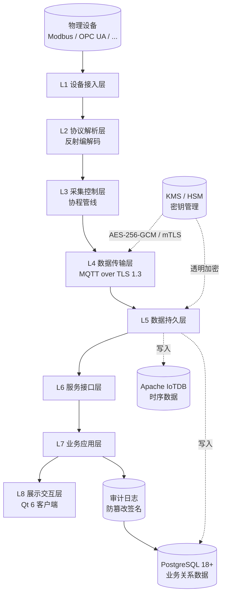
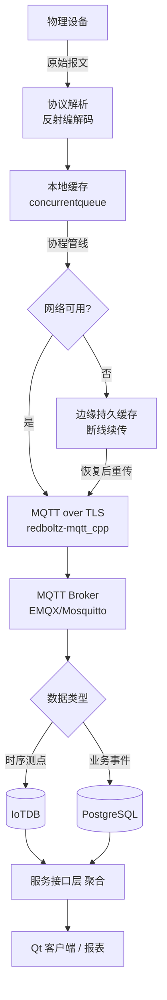
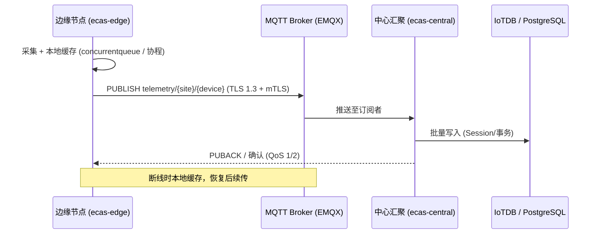
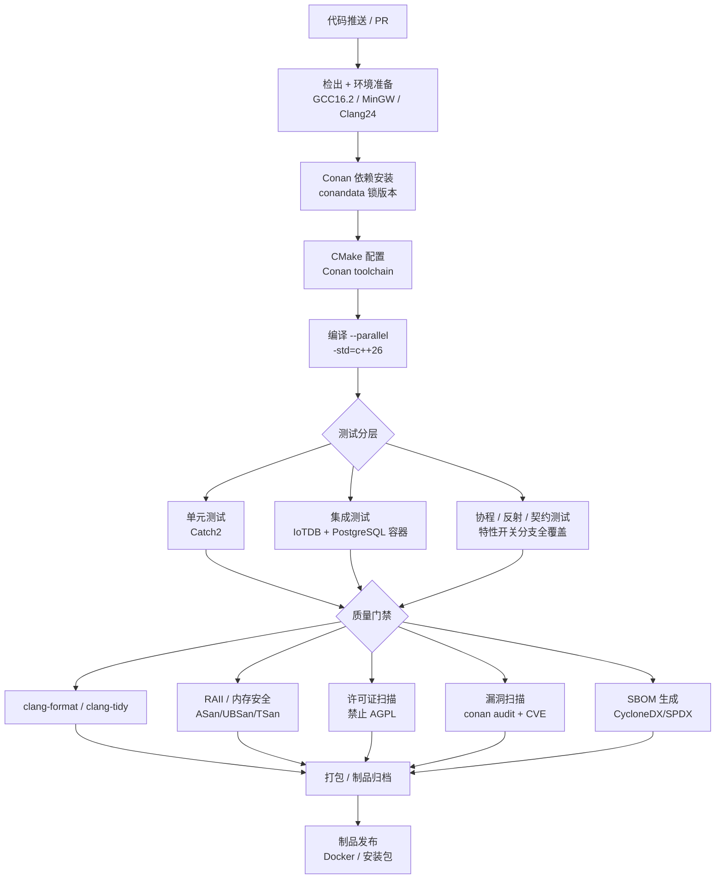

# ECAS 全局设计 — Edge-Cloud Acquisition System

> 版本：v4（架构 / 实现分离；编译器策略 v2）
> 本文描述 **系统全局设计（架构、数据流、选型、部署、CI 矩阵）**。
> **代码级规范**（RAII、错误处理、协程、反射、契约、模块接口）已独立为《实现设计》，本文仅引用其结论。
> 文档家族：`全局设计.md`（本文件）+ `实现设计.md`


---

## 0. 文档地图

| 文档           | 回答的问题                                                 | 变更频率    |
| ------------ | ----------------------------------------------------- | ------- |
| **全局设计**（本文） | 系统是什么、由哪几层构成、数据怎么流、用什么技术、如何部署、CI 跑在哪                  | 低（架构决策） |
| **实现设计**     | 代码怎么写：协程 / 反射 / 契约 / RAII / `expected` / 日志 / 接口 / 验证 | 中（编码规约） |

**边界原则**：全局设计只陈述决策与理由；凡涉及"如何编码"，一律指向《实现设计》对应章节，不在本文展开代码或函数签名。


---

## 1. 设计定位与约束

### 1.1 系统定位

ECAS（Edge-Cloud Acquisition System）是面向工业物联网的高可靠、高实时、可扩展数据采集与远程控制系统，覆盖电力、制造、能源、环保、冶金、化工等行业，支持 100+ 设备并发采集，提供 **设备接入 → 协议解析 → 加密传输 → 安全存储 → SCADA 控制** 的全链路能力。

### 1.2 五大约束（强制性，不可被局部优化推翻）

| 约束             | 说明                                                   | 落地文档             |
| -------------- | ---------------------------------------------------- | ---------------- |
| **跨平台**        | Windows / Linux / macOS 行为一致；依赖由 Conan 解析；禁止系统级硬编码路径 | 全局 §3 / 实现 §依赖管理 |
| **开源合规**       | 仅商业友好许可证；CI 强制许可证扫描 + SBOM                           | 全局 §3 / 实现 §合规门禁 |
| **审计可追溯**      | 操作、配置变更、数据访问均生成防篡改审计记录                               | 全局 §7 / 实现 §可观测性 |
| **RAII 全生命周期** | 全体 C++ 代码：资源自诞生即被析构语义确定的对象拥有                         | 实现 §RAII（核心）     |
| **错误向上管理**     | 禁止裸露异常跨越模块边界；失败必须携带上下文逐层上送                           | 实现 §错误处理（核心）     |

> 后两条是本项目的 **第一性原则**，优先级高于性能与开发便利性。"为了省事直接抛异常"或"裸指针传出去"的代码，无论性能多好，均属不合格。

### 1.3 现代化语言策略（C++26，按编译器实际能力分级）

ECAS 以 **C++26** 为基线， **最大化运用协程、静态反射、契约、Concepts、Modules、`std::expected`、`std::generator`、
`std::execution`** 等现代特性，以提升代码质量、开发效率与运行性能。但上述特性的标准支持度 **因编译器而异**，因此工具链采用
**"GCC 16.2 为主战场、Clang 24 为对标、MSVC 暂不考虑"** 的三档策略，详见 §3.2。

- **能用即用**：凡 GCC 16.2 / Clang 24 已支持的特性， **默认全量采用**，不留"为了兼容而退化"的后门。
- **演进有路**：少数仍在前沿的特性（静态反射、`std::execution`）通过 **编译期特性开关 + `if constexpr` 降级分支**
  隔离，保证不支持的编译器仍能编译通过，但 **降级分支不降低工程质量**（同样有测试覆盖，见《实现设计》§协程 / §反射）。
- **拒绝妥协**：不使用宏黑魔法、C 遗留、手动资源管理等"过时便利"。

### 1.4 设计原则（架构层面）

- **分层单向依赖**：L1→L8 依赖仅向下，上层通过抽象接口访问下层，禁止反向引用。
- **职责分离**：采集与传输解耦（队列隔离）、时序与业务分库（§4）、控制与告警分离。
- **故障即一等公民**：断线、重传、降级、告警均为主干逻辑，非事后补丁。
- **可替换性**：协议、驱动、存储后端均插件化，通过接口隔离，替换不污染调用方。
- **新特性优先**：采集 / 传输 / 查询等流式异步场景优先用协程表达；协议编解码 / 审计字段优先用静态反射；前置条件 / 不变量优先用契约（C++26 契约，或降级断言）；详见《实现设计》。


---

## 2. 整体架构

系统采用 **分层 + 微服务化** 架构，层间依赖单向向下，强制 TLS 1.3 加密通信。

| 层级 | 名称       | 核心职责                                                  |
|------|------------|-----------------------------------------------------------|
| L1   | 设备接入层 | 物理设备与通信硬件（串口、以太网、现场总线）              |
| L2   | 协议解析层 | 工业协议解析，统一数据模型抽象（反射辅助编解码）          |
| L3   | 采集控制层 | 任务调度、设备驱动、数据缓存、控制指令下发（协程驱动）    |
| L4   | 数据传输层 | 加密通信（MQTT over TLS 1.3）、断线缓冲、服务发现         |
| L5   | 数据持久层 | 时序库（IoTDB）、关系库（PostgreSQL）、配置存储、透明加密 |
| L6   | 服务接口层 | RESTful API、WebSocket、消息订阅                          |
| L7   | 业务应用层 | 告警引擎、事件处理、控制逻辑编排、权限、工单 / 库存 / BOM |
| L8   | 展示交互层 | Qt 6 桌面客户端（实时监控、图表、控制面板、报表导出）     |

### 2.1 架构总览



### 2.2 层间通信契约

| 关系    | 通信方式                                | 错误传递                                                      |
|---------|-----------------------------------------|---------------------------------------------------------------|
| L1 ↔ L2 | 同步调用（解析无阻塞）                  | 返回 `expected<ParsedFrame, ParseError>`（见 实现 §错误处理） |
| L2 ↔ L3 | 值类型 / `unique_ptr` 移交所有权        | 失败附 `Error` 向上                                           |
| L3 ↔ L4 | 无锁队列 + **协程 channel**（异步解耦） | 队列满 → 降级 + 告警                                          |
| L4 ↔ L5 | MQTT QoS 1/2 + 批量写入                 | 确认超时 → 重传                                               |
| L5 ↔ L6 | 抽象接口，具体实现注入                  | `Result<T>` 统一返回                                          |
| 跨层    | 禁止穿透调用                            | 必须经由接口层                                                |

> **所有权规则**：跨层传递的数据，要么 **值拷贝**，要么 `std::unique_ptr` **移动移交**；禁止传递裸指针或共享所有权"顺便用一下"。详见《实现设计》§RAII 规约。


---

## 3. 技术选型

### 3.1 核心组件

| 组件             | 技术选择                                                                                                          | 许可证             | 合规                                 |
|------------------|-------------------------------------------------------------------------------------------------------------------|--------------------|--------------------------------------|
| **语言标准**     | **C++26**（Modules、`import std`、Concepts、`std::expected`、`std::generator`、静态反射、`std::execution`、契约） | ISO                | —                                    |
| 构建系统         | CMake 4.3.1+                                                                                                      | BSD 3-Clause       | ✓                                   |
| 包管理           | **Conan 2.x**（`conandata.yml` 锁版本）                                                                           | MIT                | ✓                                   |
| GUI 框架         | Qt 6.11+ (Core, Widgets, Charts, Network)                                                                         | LGPLv3+ / 商业     | 闭源分发需商业许可或仅链接 LGPL 模块 |
| **时序数据库**   | **Apache IoTDB 2.0+ LTS**                                                                                         | Apache 2.0         | ✓ 端边云协同                        |
| **关系型数据库** | **PostgreSQL 18+**                                                                                                | PostgreSQL License | ✓ ACID                              |
| **MQTT 客户端**  | **redboltz-mqtt_cpp 13.2.1**                                                                                      | BSL 1.0            | ✓ 头文件库，基于 Asio               |
| 消息中间件       | EMQX / Mosquitto                                                                                                  | Apache 2.0 / EPL   | ✓                                   |
| REST API         | Crow 或 Pistache                                                                                                  | BSD / Apache 2.0   | ✓                                   |
| XML 解析         | **pugixml 1.16**                                                                                                  | MIT                | ✓                                   |
| 加密库           | **OpenSSL 3.5.7**                                                                                                 | Apache 2.0         | ✓                                   |
| 无锁队列         | **concurrentqueue 1.0.5**                                                                                         | BSD 2-Clause       | ✓                                   |
| 日期时间         | **date 3.0.5**                                                                                                    | MIT                | ✓                                   |
| 序列化           | Protocol Buffers                                                                                                  | BSD 3-Clause       | ✓                                   |
| 密钥管理         | 自研 KMS + HSM/TPM 支持                                                                                           | —                  | 内部组件                             |
| 单元测试         | **Catch2 3.15.3**                                                                                                 | BSL 1.0            | ✓                                   |
| 文档生成         | Doxygen                                                                                                           | GPL 2.0            | 仅开发期                             |
| SBOM             | CycloneDX / SPDX                                                                                                  | Apache 2.0 / MIT   | CI 生成                              |

### 3.2 编译器策略（核心决策）

ECAS 重度使用 **C++26 协程、静态反射、`std::execution`、契约** 等前沿特性，而这些特性的标准库实现进度在三大主流编译器上**严重不一致**。为避免"为了兼容最弱工具链而全体退化"或"在不可用工具链上跑出假阴性"，确立以下工具链策略：

| 优先级          | 编译器           | 角色                       | 理由                                                                                                                    |
| ------------ | ------------- | ------------------------ | --------------------------------------------------------------------------------------------------------------------- |
| **首选（主战场）**  | **GCC 16.2+** | Linux 服务端 / CI 门禁 / 全量验证 | 对协程、静态反射、 `std::execution` 、契约的 libstdc++ 支持**最完整、最前沿**，是本项目新特性的 **基准实现**                                             |
| **备选（对标验证）** | **Clang 24+** | macOS / Linux 移植性验证      | 前端 / 静态分析（clang-tidy）能力强；部分特性（反射 / execution）支持度略落后于 GCC，相关模块走 `if constexpr` 降级                                      |
| **暂不考虑**     | **MSVC**      | —                        | **对 C++26 新特性（尤其协程、 `expected` 完整语义、静态反射、 `std::execution` 、契约）支持明显滞后**，若纳入会拖累整体设计、产生大量假阴性；故在当前阶段 **明确排除**，待其支持达标后再评估 |

> **决策含义**：项目不承诺"MSVC 随时可编译"。Windows 平台的 CI 与交付统一通过 **Linux + MinGW-w64（交叉或原生）** 实现（见 §8.2），而非 MSVC。这是主动取舍： **把工程精力集中在能完整发挥 C++26 的工具链上**。

#### Windows 工具链：MinGW-w64（GCC 16.2+）

- Windows 端编译器 **MinGW-w64 提供的 GCC 16.2+**（与 Linux 主战场 **同一套前端 + libstdc++**，特性一致性最高）。
- 不在 Windows 上使用 MSVC / Clang-cl 作为主编译器。
- Qt 6 使用 **MinGW 构建套件**（与 MSVC 构建的 Qt 不二进制兼容，需统一选用 MinGW 版 Qt）。
- CI 中 Windows job 即 **`windows-latest` + MinGW-w64 + GCC 16.2**，行为与 Linux job 对齐。

#### 特性可用性矩阵（指导编码，与《实现设计》§1.2 开关一致）

| C++26 特性                            |    GCC 16.2    | Clang 24 | MSVC | 启用策略                                                                      |
|---------------------------------------|:--------------:|:--------:|:----:|-------------------------------------------------------------------------------|
| Modules / `import std`                |       ✓       |    ✓    | 滞后 | 默认全量                                                                      |
| Concepts / `requires`                 |       ✓       |    ✓    | 部分 | 默认全量                                                                      |
| `std::expected` + monadic             |       ✓       |    ✓    | 部分 | 默认全量                                                                      |
| `std::generator` / 协程               |       ✓       |    ✓    | 部分 | 默认全量（核心异步范式）                                                      |
| `std::jthread` / `mdspan` / `ranges`  |       ✓       |    ✓    | 部分 | 默认全量                                                                      |
| 静态反射（`std::meta`）               |   实验→演进    |   实验   |  ✗  | `if constexpr` 降级                                                           |
| `std::execution`（Senders/Receivers） |      演进      |   部分   |  ✗  | Asio 适配层降级                                                               |
| **契约（Contracts）**                 | 演进（需开关） |  待跟进  |  ✗  | `_Pragma`/属性守卫 + 降级 `assert`/`ensures` 宏（**非黑魔法**，见实现 §契约） |

> 所有"尚未全量可用"的特性均通过 `ecas::config::has_*` 编译期开关隔离，降级分支同样经过测试（见《实现设计》§9）。

### 3.3 依赖管理：Conan + conandata

所有第三方依赖 **统一由 Conan 2.x 解析**，版本在 `conandata.yml` **精确锁定**，禁止系统级包或版本漂移。

```yaml
# conandata.yml（依赖版本单一事实源）
requirements:
  - "pugixml/1.16"
  - "redboltz-mqtt_cpp/13.2.1"
  - "openssl/3.5.7"
  - "concurrentqueue/1.0.5"
  - "catch2/3.15.3"
  - "date/3.0.5"
```

**依赖引入三审**：许可证 ✓ + 活跃度 ✓ + **RAII / 异常友好度 / C++26 兼容性 ✓**。禁止引入持有全局状态、强制异常边界、要求手动资源回收、或与新特性不兼容的库。

> 完整依赖清单与冲突处理见《实现设计》§依赖管理。


---

## 4. 数据持久层设计

### 4.1 双库架构

ECAS 采用 **时序库 + 关系库** 职责分离：

| 数据库                   | 职责                            | 数据特征          |
| --------------------- | ----------------------------- | ------------- |
| **Apache IoTDB 2.0+** | 设备测点、实时流、历史趋势                 | 高频写入、时间序、高压缩比 |
| **PostgreSQL 18+**    | 订单、工单、库存、人员、BOM、设备元数据、权限、审计日志 | 事务性、复杂关联、强一致  |

**关联方式**：通过 **设备 ID + 时间戳** 逻辑关联； **禁止跨库 JOIN**，关联由服务接口层（L6）在内存中聚合。

### 4.2 时序模型（IoTDB）

树形 schema 天然映射工业层级：

```text
root.ecas.{site_id}.{node_id}.{device_id}.{measurement_type}
```

- 存储组 `root.ecas.{site_id}`（按站点隔离）、对齐时间序列、Schema 模板、端边云同步。
- 访问封装为 RAII 的 `IoTDBSession`，析构自动 `close`。详见《实现设计》§RAII 资源分类。

### 4.3 业务关系模型（PostgreSQL 18+）

| 表名          | 说明       | 关键字段                                                    |
|---------------|------------|-------------------------------------------------------------|
| `devices`     | 设备元数据 | device_id (PK), site_id, type, status                       |
| `orders`      | 生产订单   | order_id (PK), product_id, quantity, time range             |
| `work_orders` | 工单       | wo_id (PK), order_id (FK), device_id (FK), operator, status |
| `inventory`   | 库存       | item_id (PK), name, quantity, location                      |
| `personnel`   | 人员       | user_id (PK), name, role, department                        |
| `bom`         | 物料清单   | bom_id (PK), product_id, component_id, quantity             |
| `audit_logs`  | 审计日志   | log_id (PK), user_id, action, timestamp, signature          |

特性：分区表、JSONB、行级安全（RLS）、流复制；连接由 `PgConnectionPool`（RAII）管理。

### 4.4 数据流



### 4.5 一致性策略

- 时序 → IoTDB（高吞吐、最终一致）；业务 → PostgreSQL（ACID 强一致）。
- 跨库事件通过事件总线（L7）触发，写入 PG 并通知 IoTDB 打标。
- 全部操作落入审计（PG `audit_logs` + IoTDB 长期趋势）。


---

## 5. 通信层设计（MQTT + TLS）

L4 统一基于 **MQTT over TLS 1.3**，使用 **redboltz-mqtt_cpp**（基于 Asio，与协程 / `std::execution` 适配良好）。



**资源封装**：`MqttClient` 持有 `asio::io_context` + TLS `ssl::context`，析构自动断开；详见《实现设计》§RAII。


---

## 6. 插件与扩展

- **协议插件**：Modbus, OPC UA, Profibus, CANopen, BACnet, Siemens S7, Allen-Bradley
- **驱动插件**：设备特定驱动
- **存储插件**：`IStorageBackend` 接口
    - 默认 `storage-iotdb`（时序）、`storage-postgresql`（业务关系）
    - 备选 InfluxDB OSS / TimescaleDB / QuestDB —— **禁止 AGPL（含 TDengine 社区版）**
- **控制插件**：自定义控制逻辑

插件以动态库加载，生命周期由 `std::unique_ptr<IPlugin>` 拥有， **卸载即析构释放**。接口隔离规则详见《实现设计》§模块与接口。


---

## 7. 安全与审计

- **传输**：TLS 1.3 + mTLS，证书由 KMS 签发
- **存储**：敏感配置 AES-256-GCM（OpenSSL RAII 上下文），密钥由 KMS 管理
- **审计**：全部操作入 `audit_logs`（数字签名防篡改）；同步入 IoTDB 用于长期异常检测
- **合规**：`conan audit` + CVE 扫描、SBOM（CycloneDX/SPDX）、许可证门禁

> 加密上下文、证书、会话的 RAII 封装见《实现设计》§RAII 资源分类。


---

## 8. 构建与持续集成设计

### 8.1 设计目标

实现 **构建 → 测试 → 审计 → 打包** 全自动化；依赖经 Conan 统一解析；通过门禁保障合规与 RAII 落地。

> 本节 **仅描述流程与门禁设计**，不绑定具体流水线脚本（脚本实现见独立 CI 工作流文件）。

### 8.2 CI 平台策略（关键决策）

**前提**：ECAS 大量采用 **C++26 新机制（协程、静态反射、`std::execution`、契约）**，当前仅在 **GCC 16.2+** 上完整可用；Clang 24
对标验证； **MSVC 对前沿特性支持明显滞后，暂不纳入 CI**。

因此 CI 采用 **"Linux（GCC 16.2）+ Windows（MinGW-w64 / GCC 16.2）+ macOS（Clang 24 对标）"** 三平台矩阵， **不使用 MSVC**。这与
§3.2 的编译器策略完全一致。

| 平台                     | 编译器                    | 角色                                                              |     是否门禁     |
|--------------------------|---------------------------|-------------------------------------------------------------------|:----------------:|
| **Linux (Ubuntu 24.04)** | **GCC 16.2+**（主）       | **全量门禁**：单元 + 集成 + 基准 + sanitizer + 协程/反射/契约全开 |     ✓ 阻断      |
| **Windows (2022)**       | **MinGW-w64 + GCC 16.2+** | 交叉 / 原生编译 + 单元 + 集成（与 Linux 行为对齐）                |     ✓ 阻断      |
| **macOS (14)**           | **Clang 24+**             | 对标验证：编译 + 单元测试 + 可移植性；反射/execution 自动降级     | ✓（非阻断告警） |

> **为何 Windows 用 MinGW 而非 MSVC**：MinGW 提供与 Linux 相同的 GCC + libstdc++，C++26 新特性可用性与主战场一致，避免 MSVC 的假阴性；Qt 选用 MinGW 构建套件即可。这是当前阶段的 **主动取舍**。

#### 构建矩阵（阶段 A，当前）

| OS           | 编译器                      | 构建类型                    | 测试范围                                        |
| ------------ | ------------------------ | ----------------------- | ------------------------------------------- |
| Ubuntu 24.04 | **GCC 16.2**             | Release                 | **全量**（单元 + 集成 + 基准 + sanitizer + 协程/反射/契约） |
| Ubuntu 24.04 | GCC 16.2                 | Debug + ASan/UBSan/TSan | RAII / 内存安全 / 数据竞争                          |
| Windows 11   | **MinGW-w64 + GCC 16.2** | Release                 | 编译 + 单元测试 + 集成（Qt MinGW 套件）                 |
| Windows 11   | MinGW-w64 + GCC 16.2     | Debug                   | ASan/UB（MinGW 可用子集）                         |
| macOS 14     | **Clang 24+**            | Release                 | 编译 + 单元测试（POSIX 可移植性；反射/execution 降级分支）     |
| macOS 14     | GCC 16.2                 | Release                 | 全量                                          |

> **关于 Clang 24**：Clang 24 作为 macOS 上的对标编译器，用于验证 **代码可移植性**与触发 **clang-tidy 静态分析**；因其在静态反射 / `std::execution` 上支持略落后，相关高级特性在 macOS job 上走降级分支，不因特性缺失而阻塞整体构建。

### 8.3 CI 流程



### 8.4 测试分层

| 层级         | 方式                                 | 重点                                                                |
|--------------|--------------------------------------|---------------------------------------------------------------------|
| 单元测试     | Catch2 3.15.3                        | RAII 释放、错误码路径、日志字段、接口契约、`expected` monadic       |
| **协程测试** | Catch2 + 自研 harness                | 生成器懒性、生命周期、取消、`when_all` 聚合、`Result` 错误上送      |
| **反射测试** | Catch2                               | 协议编解码零样板、字段元数据（仅在 `has_static_reflection` 下启用） |
| **契约测试** | Catch2                               | 前置/后置条件、不变量（GCC 契约开关 vs 降级断言双路径）             |
| 集成测试     | Docker Compose（IoTDB + PostgreSQL） | 端到端：采集 → MQTT → 双库 → 查询                                   |
| 性能测试     | tsbs + 自定义基准                    | 写入/查询退化、断线续传吞吐、协程上下文切换开销                     |

### 8.5 合规门禁

| 门禁               | 规则                                                                                                            | 失败动作                    |
| ---------------- | ------------------------------------------------------------------------------------------------------------- | ----------------------- |
| 格式               | clang-format 无差异                                                                                              | 阻断                      |
| 静态分析             | clang-tidy（`cppcoreguidelines-*`、`bugprone-*`、`modernize-*`、`*-expected`、`*-raii`、`readability-avoid-macros`） | 阻断                      |
| **现代化扫描**        | 自研脚本扫描 `#define` / 裸 `new` / `printf` / 回调地狱                                                                  | 阻断（对应《实现设计》§1.1.3 禁止清单） |
| **RAII / 内存安全**  | ASan / UBSan / TSan 全绿                                                                                        | 阻断                      |
| **协程 / 反射 / 契约** | 特性开关 `on/off` 双分支均通过                                                                                          | 阻断                      |
| 许可证              | ∈ {Apache 2.0, MIT, BSL, BSD, LGPLv3+}；**AGPL 或不兼容项**                                                         | 阻断 PR                   |
| 漏洞               | `conan audit` + CVE；**CVSS ≥ 7.0**                                                                            | 阻断 PR                   |
| SBOM             | 合并 `main` 时生成并归档                                                                                              | 归档                      |

> RAII 验证细则与 sanitizer 配置见《实现设计》§质量与验证。


---

## 9. 部署

| 模式     | 构成                                                                                                      |
|----------|-----------------------------------------------------------------------------------------------------------|
| 单机开发 | IoTDB 单机 DataNode + 本地 PostgreSQL + `ecas-central` / `ecas-edge` / `ecas-ui`                          |
| 生产集群 | IoTDB ConfigNode + ≥3 DataNode；PostgreSQL 主从 + PgBouncer；EMQX 集群；ECAS 由 Docker Compose / K8s 编排 |
| 边缘     | 轻量 IoTDB + ECAS Edge，断网续传                                                                          |
| 容器化   | 统一 Dockerfile（Ubuntu 24.04 + Conan，依赖来自 conandata）                                               |


---

## 10. 现代化特性深化路线

ECAS 将持续把 **C++26 新特性** 转化为工程质量与开发效率收益：

- **协程**：`std::generator` 全面替代采集 / 查询回调；`task` + `std::execution` 构建采集→转换→传输→存储管线；`when_all`/
  `when_any` 多设备并行
- **静态反射**：协议自动编解码、审计字段自动展开、配置反序列化零样板
- **契约**：接口前置/后置条件与不变量全程校验，编译期 + 运行时双保险
- **`std::expected` 全链路化**：monadic 组合消除错误样板
- **`import std` 模块化**：编译加速、隔离
- **结构化并发**：`std::execution` 异步管线 + 协程取消传播

> 所有深化均以 **GCC 16.2 为基准**、Clang 24 对标、MSVC 待评估，遵循"可用即用、演进有路"原则（见 §3.2 与《实现设计》§1.2）。


---

> 下一步请阅读 **《实现设计》** —— 它定义本系统 **全部代码必须如何编写**：协程、反射、契约、错误处理、日志、RAII、模块接口、编码规约与验证手段。

ECAS — 为工业 4.0 构建安全、可控、合规、RAII、 **协程驱动、C++26 现代化**的数据基座。
